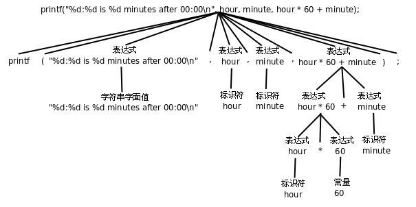

# 变量

本节介绍C语言中的变量，让我们从程序中最基本的元素常量开始。

## 常量

C中有字符（Character）常量、整数（Integer）常量、浮点数（Floating Point）常量等。

下面打印出一些常量看看（在vscode中运行variable.c文件，本节后续代码都放在本文件中了）：

```C
printf("character: %c\ninteger: %d\nfloating point: %f\n", '}', 34, 3.14);
```

这行代码中的第一个字符串称为格式化字符串（Format String），它规定了后面几个常量以何种格式插入到这个字符串中，在格式化字符串中%号（Percent Sign）后面加上字母c、d、f分别表示字符型、整型和浮点型的转换说明（Conversion Specification），转换说明只在格式化字符串中占个位置，并不出现在最终的打印结果中，这种用法通常叫做占位符（Placeholder）。

## 变量与赋值

接下来是本文的重点，变量。变量是计算机存储器中的一块命名的空间，可以在里面存储一个值（Value），存储的值是可以随时变的，所以是变量。变量也有不同的类型，变量的类型也决定了它所占的存储空间的大小。例如以下四个语句定义了四个变量fred、bob、jimmy和tom，它们的类型分别是字符型、整型、浮点型：

```C
char fred;
int bob;
float jimmy;
double tom;
```

这种定义的方式C语言中称为声明（Declaration），这里是变量声明，后面见到了还会再介绍函数声明和类型声明。如果一个变量声明要求编译器为它分配存储空间，那么也可以称为定义（Definition），因此定义是声明的一种。后面还会看到哪些变量声明不分配存储空间因而不是定义的情况，后续再详细介绍。声明和语句类似，也是以;号结尾的，但是在语法上声明和语句是有区别的，语句只能出现在{}括号中，而声明既可以出现在{}中也可以出现在所有{}之外。

给变量起名有一定的限制，C语言规定必须以字母或下划线_（Underscore）开头，后面可以跟若干个字母、数字、下划线，但不能有其它字符。另外，在C语言中有些单词有特殊意义，不允许用作标识符，这些单词称为关键字（Keyword）或保留字（Reserved Word）。还有一点要注意，一般来说应避免使用以下划线开头的标识符，以下划线开头的标识符只要不和C语言关键字冲突的都是合法的，但是往往被编译器用作一些功能扩展，C标准库也定义了很多以下划线开头的标识符，所以除非你对编译器和C标准库特别清楚，一般应避免使用这种标识符，以免造成命名冲突。

有了变量之后，要把值存到存储空间里，可以用赋值语句实现：

```C
char firstletter;
int hour, minute;
firstletter = 'a';   /* give firstletter the value 'a' */
hour = 11;           /* assign the value 11 to hour */
minute = 59;         /* set minute to 59 */
```

注意变量一定要先声明后使用，编译器必须先看到变量声明，才知道firstletter、hour和minute是变量名，各自代表一块存储空间。另外，变量声明中的类型表明这个变量代表多大的一块存储空间，这样编译器才知道如何读写这块存储空间。还要注意，这里的等号不表示数学里的相等关系，和1+1=2的等号是不同的，这里的等号表示赋值。定义一个变量，就是分配一块存储空间并给它命名；给一个变量赋值，就是把一个值保存到这块存储空间中。变量的定义和赋值也可以一步完成，这称为变量的初始化（Initialization），例如要达到上面代码的效果也可以这样写：

```C
char firstletter = 'a';
int hour = 11, minute = 59;
```

在初始化语句中，等号右边的值叫做Initializer，例如上面的'a'、11和59。注意，初始化是一种特殊的声明，而不是一种赋值语句。先定义一个变量再给它赋值和定义这个变量的同时给它初始化所达到的效果是一样的，C语言的很多语法规则既适用于赋值也适用于初始化，但它们之间是不同的，后续我们会看到。

现在我们取出这些变量的值用printf打印：

```C
printf("Current time is %d:%d", hour, minute);
```

变量名用在等号左边表示赋值，而用在printf中表示把它的存储空间中的值取出来替换在那里。不同类型的变量所占的存储空间大小是不同的，数据表示方式也不同，变量的最小存储单位是字节（Byte），在C语言中char型变量占一个字节，其它类型的变量占多少字节在不同平台上有不同的规定，后面会更详细讨论

## 表达式

常量和变量都可以参与加减乘除运算，例如1+1、hour-1、hour * 60 + minute、minute/60等。这里的+ - * /称为运算符（Operator），而参与运算的常量和变量称为操作数（Operand），上面四个由运算符和操作数所组成的算式称为表达式（Expression）。

运算符是有优先级（Precedence）的，比如\*和/是同一优先级，+和-是同一优先级，\*和/的优先级高于+和-。对于同一优先级的运算从左到右计算，如果不希望按默认的优先级计算则要加()括号（Parenthesis）。

前面讲过打印语句和赋值语句，现在我们定义：在任意表达式后面加个;号也是一种语句，称为表达式语句。比如：

```C
int total_minute;
total_minute = hour * 60 + minute;
```

这个语句把计算结果保存在另一个变量total_minute里。事实上等号也是一种运算符，称为赋值运算符，赋值语句就是一种表达式语句，等号的优先级比+和*都低，所以先算出等号右边的结果然后才做赋值操作，整个表达式total_minute = hour * 60 + minute加个;号构成一个语句。

任何表达式都有值和类型两个基本属性。hour * 60 + minute的值是由三个int型的操作数计算出来的，所以这个表达式的类型也是int型。同理，表达式total_minute = hour * 60 + minute的类型也是int，它的值是多少呢？C语言规定等号运算符的计算结果就是等号左边被赋予的那个值，所以这个表达式的值和hour * 60 + minute的值相同，也和total_minute的值相同。

等号运算符还有一个和+ - * /不同的特性，如果一个表达式中出现多个等号，不是从左到右计算而是从右到左计算。同样优先级的运算符是从左到右计算还是从右到左计算称为运算符的结合性（Associativity）。+ - * /是左结合的，等号是右结合的。

表达式可以是单个的常量或变量，也可以是组合成的更复杂的表达式。以前我们用printf打印常量或变量的值，现在可以用printf打印更复杂的表达式的值

```C
printf("%d:%d is %d minutes after 00:00\n", hour, minute, hour * 60 + minute);
```

编译器在翻译这条语句时，首先根据上述语法规则把这个语句解析成下图所示的语法树，然后再根据语法树生成相应的指令。语法树的末端的是一个个Token，每一步展开利用一条语法规则。



理解组合（Composition）规则是理解语法规则的关键所在，正因为可以根据语法规则任意组合，我们才可以用简单的常量、变量、表达式、语句搭建出任意复杂的程序。不过表达式不宜过度组合，否则会给阅读和调试带来困难。

根据语法规则组合出来的表达式在语义上并不总是正确的，例如：minute + 1 = hour; 等号左边的表达式要求表示一个存储位置而不是一个值，这是等号运算符和+ - * /运算符的又一个显著不同。有的表达式既可以表示一个存储位置也可以表示一个值，而有的表达式只能表示值，不能表示存储位置，例如minute + 1这个表达式就不能表示存储位置，放在等号左边是语义错误。表达式所表示的存储位置称为左值（lvalue）（允许放在等号左边），而以前我们所说的表达式的值也称为右值（rvalue）（只能放在等号右边）。上面的话换一种说法就是：有的表达式既可以做左值也可以做右值，而有的表达式只能做右值。

看一个有意思的例子，如果定义三个变量int a, b, c;，表达式a = b = c是合法的，先求b = c的值，再把这个值赋给a，而表达式(a = b) = c是不合法的，先求(a = b)的值没问题，但(a = b)这个表达式不能再做左值了，因此放在= c的等号左边是错的。

关于整数除法运算有一点特殊之处：

```C
hour = 11;
minute = 59;
printf("%d and %d hours\n", hour, minute / 60);
```

执行结果是11 and 0 hours，也就是说59/60得0，这是因为两个int型操作数相除的表达式仍为int型，只能保存计算结果的整数部分，即使小数部分是0.98也要舍去。

向下取整的运算称为Floor，用数学符号⌊⌋表示；向上取整的运算称为Ceiling，用数学符号⌈⌉表示。例如：

⌊59/60⌋=0

⌈59/60⌉=1

⌊-59/60⌋=-1

⌈-59/60⌉=0

在C语言中整数除法取的既不是Floor也不是Ceiling，无论操作数是正是负总是把小数部分截掉，在数轴上向零的方向取整（Truncate toward Zero），或者说当操作数为正的时候相当于Floor，当操作符为负的时候相当于Ceiling。回到先前的例子，要得到更精确的结果可以这样：

```C
printf("%d hours and %d percent of an hour\n", hour, minute * 100 / 60);
printf("%d and %f hours\n", hour, minute / 60.0);
```

在第二个printf中，表达式是minute / 60.0，60.0是double型的，/运算符要求左右两边的操作数类型一致，而现在并不一致。C语言规定了一套隐式类型转换规则，在这里编译器自动把左边的minute也转成double型来计算，整个表达式的值也是double型的，在格式化字符串中应该用%f转换说明与之对应。本来编程语言作为一种形式语言要求有简单而严格的规则，自动类型转换规则不仅很复杂，而且使C语言的形式看起来也不那么严格了，C语言这么设计是为了书写程序简便而做的折衷，有些事情编译器可以自动做好，程序员就不必每次都写一堆繁琐的转换代码。然而C语言的类型转换规则非常难掌握，后面具体到介绍“类型转换”时候再集中解决这个问题。

## 字符

字符常量或字符型变量也可以当作整数参与运算，例如：

```C
printf("%c\n", 'a'+1);
```

执行结果是b。

符号在计算机内部也用数字表示，每个字符在计算机内部用一个整数表示，称为字符编码（Character Encoding），目前最常用的是ASCII码（American Standard Code for Information Interchange，美国信息交换标准码）。在ASCII码中字符a是97，字符b是98。计算'a'+1这个表达式，应该按ASCII码把'a'当作整数值97，然后加1，得到98，然后printf把98这个整数值当作ASCII码来解释，打印出相应的字符b。

之前说“整型”是指int型，而现在我们知道char型本质上就是整数，只不过取值范围比int型小，所以以后我们把char型和int型统称为整数类型（Integer Type）或简称整型。

字符'a'~'z'、'A'~'Z'、'0'~'9'的ASCII码都是连续的，因此表达式'a'+25和'z'的值相等，'0'+9和'9'的值也相等。注意'0'~'9'的ASCII码是十六进制的30~39，和整数值0~9是不相等的。

字符也可以用ASCII码转义序列表示，这种转义序列由\加上1~3个八进制数字组成，或者由\x或大写\X加上1~2个十六进制数字组成，可以用在字符常量或字符串字面值中。例如'\0'表示NUL字符（Null Character），'\11'或'\x9'表示Tab字符，"\11"或"\x9"表示由Tab字符组成的字符串。注意'0'的ASCII码是48，而'\0'的ASCII码是0，两者是不同的。