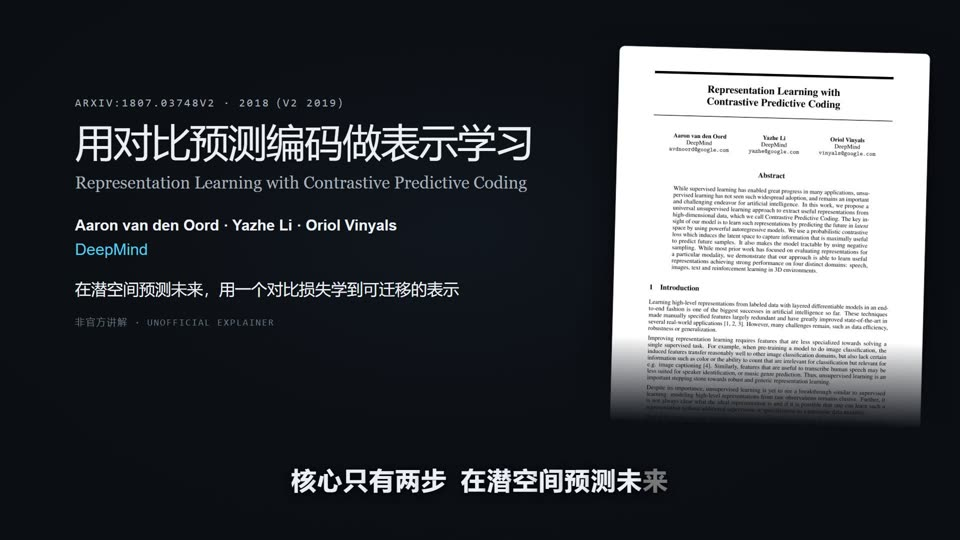

# mylibrary — Research workspace for hydrology and water resources

**English** · [简体中文](README-zh.md) · [Online documentation (Chinese)](https://iheadwater.github.io/mylibrary/)

mylibrary helps you collect papers in Zotero, read and organize them, and turn them into reusable evidence cards, reviews, articles, and animated explainers. The upstream [dailyinfo](https://github.com/iHeadWater/dailyinfo) project collects research updates before papers enter Zotero.

## See it in action

Two papers, turned into narrated Chinese explainers by the same workflow — no manual editing:

| [](https://www.bilibili.com/video/BV1xGWu68E3x) | [](https://www.bilibili.com/video/BV1NGWu68E8L) |
|---|---|
| **DrLIM** · Hadsell, Chopra & LeCun, CVPR 2006 — learn an invariant mapping with a contrastive loss · [Watch on Bilibili →](https://www.bilibili.com/video/BV1xGWu68E3x) | **CPC** · van den Oord, Li & Vinyals, DeepMind 2018 — predict the future in latent space with InfoNCE · [Watch on Bilibili →](https://www.bilibili.com/video/BV1NGWu68E8L) |

## Quick start

Open the cloned `mylibrary` folder in your coding agent, such as Claude Code or Codex. Run commands from the repository root.

```bash
git clone https://github.com/iHeadWater/mylibrary.git
cd mylibrary
uv sync --locked
cp .env.example .env
```

The project uses Git, Python 3.12–3.14, and [uv](https://docs.astral.sh/uv/). `uv sync --locked` installs the Python dependencies for the single `hydrolitagent` package into `.venv` from `uv.lock`. Fill in only the credentials needed for your workflow.

| Workflow | Additional setup |
|---|---|
| Query or write to Zotero through the Web API | Zotero API key and library ID |
| Read local Zotero PDFs | Zotero Desktop running with local API access enabled |
| Import PDFs as linked attachments | Configure the PDF folder and Zotero's Linked Attachment Base Directory |
| Generate cards through a model API | Set `DEEPSEEK_API_KEY` for the default direct runner. The current agent can also generate cards without a separate key |
| Create animated paper explainers | Install Node.js 20+ with npm and FFmpeg with FFprobe. Use `uv sync --locked --extra paper-video` for Python dependencies, then follow the [video setup guide](docs/user-guide/paper-video.md) for Remotion. |

See the [installation guide](docs/getting-started/installation.md) for configuration details.

## What you can ask your agent to do

| Example request | Result | Guide |
|---|---|---|
| Download this paper and add it to Zotero | Resolve a DOI, arXiv ID, or title and create a Zotero entry with a linked PDF | [Paper ingestion](docs/user-guide/paper-pipeline.md) |
| Find papers in my Zotero library | Search and read items, attachments, and annotations | [Zotero MCP tools](docs/user-guide/mcp-tools.md) |
| Turn this paper into an evidence card | Read the PDF and create a card with source references | [Evidence cards and topics](docs/user-guide/cards/index.md) |
| Find recurring themes in these papers | Generate candidate topics from cards and organize the results for review | [Topic pool](docs/user-guide/cards/unified-theme-pool.md) |
| Write a weekly review for WeChat | Analyze full texts, group papers by theme, and draft an article | [Literature workflows](docs/user-guide/literature.md) |
| Turn this paper into a Chinese animated explainer | Produce a narrated video, subtitles, and an editable project | [Paper video](docs/user-guide/paper-video.md) |
| Find publication statistics for this researcher or institution | Resolve identities and summarize publication records with OpenAlex | [Publication statistics](docs/user-guide/scholars/index.md) |

You can also [browse the reading outputs in Obsidian](docs/user-guide/cards/reading-in-obsidian.md) or [check the model and output paths](docs/user-guide/cards/runtime-maintenance.md).

## Command-line examples

```bash
# Start the Zotero MCP server on port 8002
uv run python -m hydrolitagent.zotero.server

# Download a PDF and add it to Zotero
uv run python scripts/download_paper.py --doi "10.1016/j.jhydrol.2023.130249" --sync

# Resolve a Zotero paper and inspect card settings
uv run hydrolitagent cards paper-input --user-library --item-key ABCD1234 --json
uv run hydrolitagent cards ai-config --json

# Build the reading index or check publication statistics
uv run hydrolitagent cards index --json
uv run hydrolitagent scholars resolve --name "Zhang San" --json
```

For additional commands, see the [quick-start guide](docs/getting-started/quickstart.md), [literature workflows](docs/user-guide/literature.md), and [repository architecture](docs/development/architecture.md). Project agent skills live in [skills/](skills/).

## Documentation and tests

```bash
uv run mkdocs serve
uv run mkdocs build --strict
uv run pytest
```

The Zotero integration tests require a running local Zotero instance and suitable library fixtures. See [the test source](tests/test_zotero_local_api_integration.py).

## Contributing and license

Contributions are welcome. Open a pull request describing the change and include only material you have permission to share. mylibrary is licensed under the **GNU Affero General Public License v3.0**. See [LICENSE](LICENSE).
