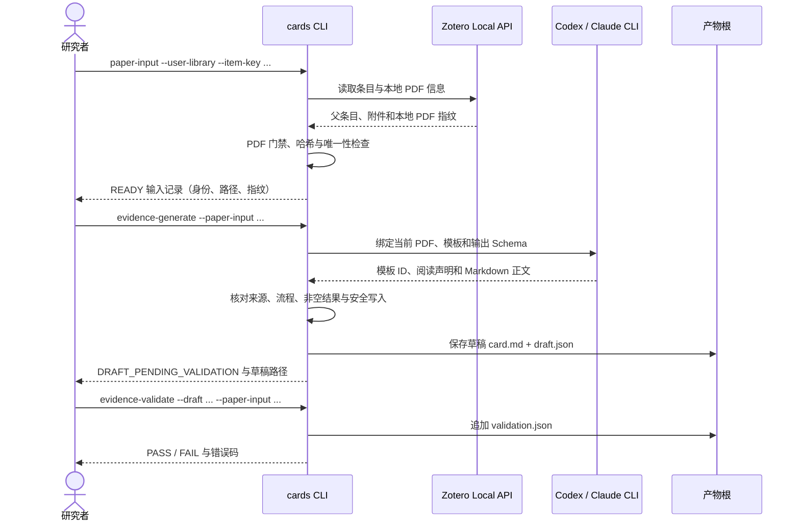
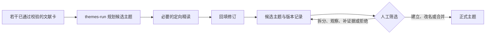

# 数据流与用户流程

本文说明最小核心的运行链路及目标中的人工科研闭环。技术模块见[技术架构](architecture.md)，完整目标设计见[项目级设计](project-design.md)。

## 单篇数据流

这条链路就是当前实现的单篇核心。模型失败、来源变化、PDF 不完整或写入冲突时，程序保留已有结果和诊断信息，不把半成品宣布为完成。相同输入且已有完整成果时应复用，不重复调用模型。

## 主题数据流

候选主题可以由模型形成和演化，但只有带人员、时间和理由的人工决定才能建立、改名、合并或拆分正式主题。

## 用户流程

### 首次使用

1. 准备 Zotero Desktop、已下载的 PDF，以及一种已登录的 CLI（Codex 或 Claude）。PDF 由 Python 转换，不需要 Poppler。
2. 克隆仓库并执行 `uv sync --all-packages`。
3. 按[文献卡与主题卡概述](../../user-guide/cards/index.md)选一篇自己的论文，依次完成输入、生成与校验。

### 日常研究

1. 研究者从自己的 Zotero 中选定一篇论文，运行 `paper-input` 得到 READY 记录。
2. 运行 `evidence-generate` 生成主体卡草稿，再运行 `evidence-validate` 校验。
3. 累积若干通过校验的文献卡后运行 `themes-run`，形成或更新候选主题。
4. 研究者阅读文献卡与候选主题，检查来源、边界和代表证据。
5. 主题足够成熟时由研究者人工确认正式主题；系统只执行被允许的变更。

当前实现的边界止于候选主题。Obsidian 受控搜索与写入、正式主题确认命令和 idea 模块属于目标设计，尚未进入当前运行命令。

## 人工与自动化边界

| 动作 | 自动化是否可以直接执行 | 约束 |
| --- | --- | --- |
| 读取 Zotero、检查 PDF | 可以 | 只访问本机文库与配置指定的路径 |
| 生成主体卡草稿 | 可以 | 保留来源身份和流程记录，不宣称科学核验 |
| 代码校验主体卡 | 可以 | 只做确定性检查，不证明科研内容正确 |
| 创建或修订候选主题 | 可以 | 不能修改正式主题，不得删除历史 |
| 建立、合并、拆分正式主题 | 不可以 | 必须有人工决定记录 |
| 写入 Obsidian 正式知识区 | 尚未实现 | 第一阶段只读 |
| 提交或推送 Git | 不可以 | 只有用户明确要求时由维护者执行 |

## 失败与处理

- 无全文或 PDF 不完整：停止并说明原因，不生成草稿。
- CLI 不可用或认证失败：按配置执行有限重试和冷却，保存脱敏诊断，不无限调用。
- 校验失败：返回错误码、字段路径和原因，定向修正后重新校验。
- 产物发生人工修改或来源冲突：停止覆盖，要求人工判断。
- 主题处理部分失败：旧候选继续有效，全部替代结果准备完成后才发布新版本。
