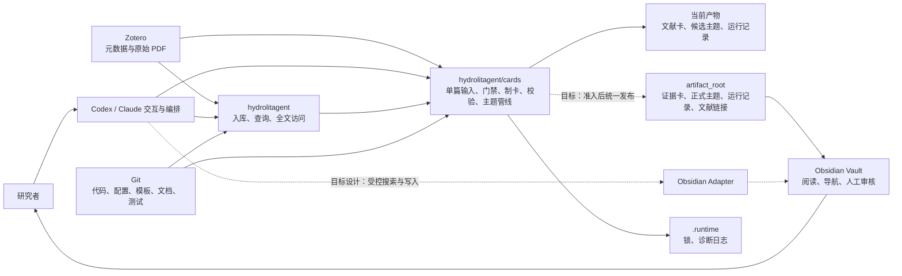
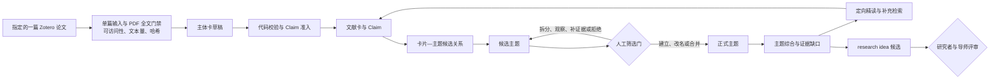
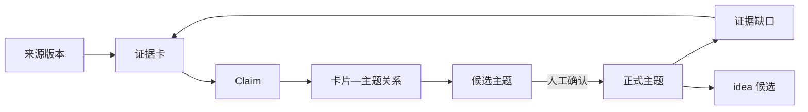

# 文献研究平台项目级设计

本文面向项目评审、新成员上手和后续开发，说明 `iHeadWater/mylibrary` 仓库承载的文献研究平台。文档以**当前代码能证明的**实现为基础，同时给出尚未完成部分的目标设计和验收边界。规划中的能力会明确标注为“目标设计”，不得据此宣称代码、配置或运行链路已经存在。

| 交付边界 | 内容 |
| --- | --- |
| 当前已经实现 | Zotero 文献入库与查询、单篇论文输入、PDF 全文门禁、Codex / Claude 单 Agent 制卡、九类证据卡模板、主体卡代码校验、统一候选主题池、`artifact_root` 路径解析与校验、CLI 基础设施 |
| 已完成设计、尚待实现 | 自动化产物到 `artifact_root` 的统一发布、Codex 与 Obsidian 的正式集成、候选主题人工确认闭环、稳定的主题层级与卡片—主题关系、主题到 research idea 的生成与评审 |

## 1. 总体架构

平台以 Zotero 为文献和原始 PDF 的事实来源，以 Codex / Claude 为内容提炼入口，以 Obsidian 为面向研究者的知识阅读和审核空间。`hydrolitagent` 提供文献入库、检索和全文访问能力，`hydrolitagent/cards/` 负责单篇论文输入、全文门禁、模型调用、主体卡校验、产物保存、主题候选更新与运行记录。Git 管理代码、配置结构、Skills、模板、Schema、测试和项目文档；实际证据卡、主题、PDF、运行日志等科研产物不进入 Git。



当前分支已经实现 Zotero、单篇处理链路和 Codex / Claude CLI 制卡，Markdown 产物也可以被 Obsidian 直接打开；但自动化产物写入 `--output-root`（默认 `outputs/`）与 `paths.themes_dir`。`artifact_root` 下四个科研目录目前只完成配置解析与路径校验，尚未成为自动发布目标。目标架构需要新增独立的 Obsidian Adapter：后台搜索和读取优先使用文件型 MCP，桌面打开和差异复核使用 Obsidian 官方 CLI，需要访问当前活动笔记时再启用 Local REST API。三种接口不得同时写同一个文件。

正式主题和 research idea 都属于需要人类决策的科研对象。自动化可以提出候选、整理证据和生成草稿，但不能越过人工确认门直接建立正式主题，也不能把“当前文献中尚未发现”自动解释为学术创新。

## 2. 数据流

主链路从 Zotero 新文献开始，以可追溯的证据和主题为中间资产，最终为研究问题与 idea 判断提供材料。



当前自动化已经覆盖从单篇输入到文献卡、主题池的主要技术链路。目标设计对这条链路增加四项约束：

1. **来源不可替代。** Zotero 元数据只负责识别来源，科学结论必须回到经过校验的原始 PDF 和可定位证据。
2. **证据卡相对稳定。** 主题变化只更新卡片—主题关系和主题综合，不重复改写证据卡中的原文事实。
3. **候选主题与正式主题分离。** 现有自动主题池应定位为候选发现层；没有人工决定记录时，不能生成正式主题。
4. **idea 与证据质量分离。** 时效、引用和热点增长可以帮助排列 idea 优先级，但不能提高 Claim 的真实性或证据等级。

平台的核心数据对象及其生命周期如下。

| 对象 | 主要内容 | 负责模块 | 生命周期规则 |
| --- | --- | --- | --- |
| Zotero 来源 | 条目、附件、元数据、原始 PDF | Zotero / `hydrolitagent` | 原始来源保持可追溯，不由主题模块修改 |
| 单篇输入与草稿 | 来源快照、PDF 哈希、模型输出与校验记录 | `hydrolitagent/cards/` | 每次处理留痕，用于复核与追溯 |
| 证据卡 | 来源解释、Claim、定位、边界、阅读深度 | 证据卡 Skill | 一项来源登记一次；纠错和升级可以修订，主题变化不能触发重写 |
| 卡片—主题关系 | 卡片或 Claim 对主题的作用、理由与审核结果 | 主题工作流 | 独立于证据卡演化，允许建立、拒绝、撤销和替代 |
| 候选主题 | 暂定问题、边界假设、代表来源和歧义来源 | 自动化与主题 Skill | 只能用于筛选，不得承担正式综合结论 |
| 正式主题 | 人工确认的研究问题、边界、层级、证据综合和缺口 | 主题 Skill + 人工审核 | 建立、改名、合并、拆分和归档必须留下决定记录 |
| idea 候选 | 可检验问题、证据基础、缺口、方法和可行性 | 后续 idea 模块 | 必须回链正式主题和 Claim，经研究者与导师判断后才能采用 |

## 3. 用户流程

### 首次配置

1. 安装并启动 Zotero，确认目标文库和 PDF 可以从本机访问。
2. 克隆 `mylibrary`，使用 uv 安装整个 workspace。
3. 配置模型与产物目录，安装并登录一种 CLI（Codex 或 Claude），并准备 Poppler。
4. 核对当前产物目录与 `artifact_root` 的实际解析路径。在统一发布实现前，用户可以用 Obsidian 打开相应 Markdown 目录，但不应依赖修改 `artifact_root` 来自动搬运现有文献卡和候选主题。

### 日常研究

1. 用户在 Codex / Claude 中提出任务，例如处理一篇指定文献、查看某主题证据或分析研究缺口。
2. 平台读取 Zotero 与 PDF、生成或校验主体卡，并在累积若干文献卡后形成候选主题。
3. 用户在 Obsidian 中阅读证据卡和候选主题，检查来源、边界、代表文献和相邻主题。
4. 用户通过 Codex 作出建立、改名、合并、拆分、观察、补证据或拒绝决定；系统保存决定及理由。
5. 正式主题根据已接受的 Claim 形成综合，列出争议、迁移边界和待补证据。
6. 当主题足够成熟时，系统生成 idea 候选；研究者和导师决定是否继续验证或进入研究设计。

当前能够运行的是前两步以及对 Markdown 结果的人工查看。第三至第六步已有主题 Skill 和模板基础，但还没有形成 Codex—Obsidian—人工决定—正式主题—idea 的完整产品闭环。目标实现必须让用户能够看到每次建议的依据和将要发生的写入，并允许拒绝，而不是让自动化在后台直接改变正式科研对象。

异常情况下，单篇文献失败不得阻断已经完成的产物；系统应记录失败原因、重试次数和诊断日志。Zotero 不可访问、PDF 不完整、模型失败或人工尚未决定时，分别保留在来源、任务、候选主题或审核阶段，不得伪造后续成功状态。

## 4. 模块边界

| 模块 | 负责什么 | 明确不负责什么 |
| --- | --- | --- |
| Zotero | 保存来源、附件、元数据与原始 PDF | 不保存正式主题判断，不承担知识综合 |
| `hydrolitagent` | 文献入库、Zotero 查询、全文与附件访问、其他文献工具 | 不决定主题生命周期，不替代人工审核 |
| `hydrolitagent/cards/` | 单篇论文输入、PDF 门禁、Codex / Claude 调用、主体卡校验、候选主题池 | 不把自动聚类直接宣布为正式主题或 idea |
| 证据卡 Skill | 定义来源分类、阅读深度、Claim、定位、推断边界与卡片验收 | 不决定某张卡必须归入哪个正式主题 |
| 主题 Skill | 候选主题发现、人工筛选门、正式主题综合、反馈和补证据工作流 | 不修改原始来源，不允许模型独立建立正式主题 |
| 科研产物目录 | 保存证据卡、主题、运行记录和文献链接，并维持相对引用 | 不保存密钥，不代替 Git 管理代码和模板 |
| Obsidian | 阅读、导航、双向链接、人工编辑与审核科研知识 | 不执行扫描、全文门禁和模型任务调度 |
| Obsidian Adapter（目标设计） | 为 Codex 提供 Vault 搜索、读取、打开、受控写入和冲突检测 | 不包含制卡或主题判断逻辑，不拥有来源与主题生命周期 |
| Codex | 接收自然语言任务、选择工具、组织结果和请求人工决定 | 不绕过配置、Schema、写入范围和人工门禁 |
| Git | 管理可复现的代码、配置结构、模板、文档和测试 | 不跟踪 PDF、正式科研产物、密钥和机器运行状态 |

模块之间通过稳定对象交接：Zotero 向处理层提供来源和 PDF，处理层向证据层提供经过门禁的来源快照，证据层向主题层提供卡片和 Claim，主题层向交互层提供候选与需要人工决定的问题。任何跨模块写入都必须由拥有该对象生命周期的模块执行。

## 5. 配置

当前团队级总配置为 `hydrolitagent/cards/assets/config/config.json`，完整示例为 `hydrolitagent/cards/assets/config/config.example.json`。个人机器覆盖使用被 Git 忽略的完整 `config.local.json`，并通过 `--config` 或 `HYDROLITAGENT_CARDS_CONFIG` 显式选择；系统不进行隐式配置合并。

| 配置组 | 当前用途 |
| --- | --- |
| `paths` | 项目、运行区、模板、Schema 及科研产物目录 |
| `zotero` | 本地 API、文库/群组、请求超时 |
| `pdf_gate` | PDF 可用性门禁 |
| `card_generator` | Codex CLI、模型、推理强度、超时、代理和 PDF 读取方式 |
| `theme_pipeline` | 主题管线、研究目标、模型继承和主题模板目录 |

`paths` 中存在两组产物契约。单篇流程写入 `--output-root`（默认 `outputs/`），主题池写入 `paths.themes_dir`，它们相对 `project_root` 解析。`artifact_root` 下的 `evidence_cards_dir`、`themes_vault_dir`、`run_records_dir` 和 `literature_index_dir` 已能安全解析，但当前代码未将前者发布到后一组。

目标设计将 `artifact_root` 作为 Obsidian 阅读与人工审核层的共同父目录，四类产物必须同根以避免相互引用失效。如果使用已有 Vault，应放在一个明确的项目子目录中；在发布器实现前，不应让两套流程同时写同一文件。

下面是 Obsidian 接入的**拟议配置契约**，当前程序尚不读取这些字段。字段名称在实现时可以调整，但权限语义和验收规则不得被省略。

```json
{
  "obsidian": {
    "enabled": false,
    "vault_path": null,
    "vault_alias": "hydro",
    "mcp": {
      "enabled": true,
      "mode": "read_only"
    },
    "cli": {
      "enabled": true
    },
    "rest_api": {
      "enabled": false,
      "base_url": null,
      "token_env": "OBSIDIAN_REST_API_TOKEN"
    },
    "write_policy": {
      "allowed_directories": ["Codex草稿", "人工协作"],
      "require_etag": true,
      "allow_delete": false,
      "allow_move": false,
      "allow_bulk_rename": false,
      "allow_bulk_tagging": false
    }
  }
}
```

第一阶段只开放 Vault 列表、搜索和读取。第二阶段通过试验后，才允许向指定草稿目录创建或编辑文件，并使用 etag 或等价机制防止覆盖用户修改。Local REST API 默认关闭，仅在确实需要读取当前活动笔记或调用 Obsidian 内部命令时启用。Obsidian Token、Zotero API Key、GitHub Token和登录凭据只能放在环境变量或本机凭据存储中。

新增配置项必须同时交付解析、校验、实现、测试和文档。只在 JSON 中加入程序不读取的字段不能算完成；未知接口、越界路径和不支持的写入方式必须立即报错。

## 6. 运行步骤

### 当前可运行流程

在 Windows PowerShell 中执行：

```powershell
git clone https://github.com/iHeadWater/mylibrary.git
Set-Location mylibrary
git switch main

uv sync --all-packages
Copy-Item .env.example .env
```

填写本机环境变量与配置后，先做只读自查：

```powershell
uv run hydrolitagent cards ai-config --json
```

确认模型选择与产物根后，按单篇流程处理自己的论文：

```powershell
uv run python scripts/paper_input.py --user-library --item-key ABCD1234 --output paper-input.json
uv run hydrolitagent cards evidence-generate --paper-input paper-input.json --ai-provider codex --json
uv run hydrolitagent cards evidence-validate --draft <草稿目录>/draft.json --paper-input paper-input.json --json
```

开发或交付前运行文档和测试检查：

```powershell
uv run mkdocs serve
uv run pytest --ignore=tests/test_zotero_local_api_integration.py
python skills/hydrology-evidence-cards/tests/self_test.py
python skills/hydrology-theme-synthesis/tests/self_test.py
```

当前已知 `tests/test_zotero_local_api_integration.py` 与安装的 `mcp` 包接口不兼容，因此全量测试需要暂时忽略该文件；这项例外应保留明确说明，不能把跳过后的通过描述为该集成测试已经通过。

### Obsidian 闭环的目标运行方式

1. 打开配置指定的 Vault，确认四类科研产物目录和草稿目录存在。
2. 启动只授权该 Vault 的文件型 MCP，第一阶段以只读模式注册到 Codex。
3. Codex完成检索或生成后，使用Obsidian CLI打开目标笔记，用户查看内容和差异。
4. 用户确认写入后，Codex只能修改允许目录；保存前校验版本，发生冲突时停止并展示差异。
5. 需要操作当前活动笔记时，才临时使用Local REST API；它不能与文件型MCP同时自动写入同一文件。

Obsidian接入的完成标准不是“Markdown能被Obsidian打开”，而是：Codex能够限定Vault搜索；搜索结果可定位并打开；写入受到目录和操作类型限制；并发修改不会静默覆盖；删除和批量变更默认不可用；每次主题正式化都有可审查的人工决定记录。

## 7. 证据卡/主题模板及其关系

### 证据卡

仓库包含九类证据卡：原创研究、综述与证据综合、调查监测与统计报告、工程项目报告、图书与章节、标准指南与政策、数据集及数据产品、软件模型与代码、平台证据综合与决策卡。科研语义和阅读规范来自 `hydrology-evidence-cards`；自动化平台那套是在它的正文骨架上增加了管线字段、信息边界和第九类决策卡后的适配版本，**不是**另一套互相竞争的体系。

一张来源证据卡应登记准确来源版本，说明研究问题、对象与边界、数据、方法链、验证或比较设计、关键结果、作者解释、分析者判断和结论边界。可以从 L0/L1 提升到 L2/L3，也可以因来源核对而纠错；但不能因为主题名称变化而重新解释原文。只有来源核验过的 L2/L3 Claim 才能支撑正式主题结论。

### 主题

主题不是标签或关键词集合，而是供研究者持续阅读和判断的研究问题文档。主题体系分为候选主题和正式主题：候选主题可以由小样本文献或大规模语料自动发现；正式主题必须经过人工筛选，并记录核心问题、纳入与排除边界、层级、证据结构、研究脉络、当前综合、异质性与争议、证据缺口和下一步补证据任务。

每个正式主题至少需要以下结构：

| 部分 | 内容 |
| --- | --- |
| 身份与层级 | `theme_id`、名称、一级/二级/三级、父主题、子主题和相邻主题 |
| 研究边界 | 核心问题、目标对象、时间与空间范围、纳入和排除规则 |
| 证据结构 | 支持、限制、反对和背景 Claim，以及来源独立性和版本关系 |
| 综合判断 | 当前最强结论、允许的措辞、适用边界和仍不支持的部分 |
| 研究脉络 | 问题、数据、方法、验证和应用范围如何演变 |
| 缺口与反馈 | 需要复核的来源、需要补充的语料和需要修正的发现模型 |
| 人工决定 | 建立、改名、合并、拆分、观察或归档的人员、时间和理由 |

一级主题表示长期研究方向，二级主题表示其中相对稳定的问题群，三级主题只在证据规模和问题边界确实需要时建立。系统必须检查父子循环和重复边界。主题合并、拆分或改名不能删除历史身份；旧主题保留变更记录，并通过 `superseded_by` 等关系指向后继主题。

### 证据卡—主题关系



卡片与主题之间必须使用独立关系记录，不能只靠把主题名称写进证据卡。拟议关系对象如下：

```yaml
relation_id: REL-...
card_id: CARD-...
claim_ids:
  - CLAIM-...
theme_id: THEME-...
relation_type: supports | limits | opposes | contextual | method_reference
review_state: proposed | confirmed | rejected | superseded
rationale: "为什么这些 Claim 与该主题有关"
proposed_by: agent-or-user
reviewed_by: null
created_at: null
superseded_by: null
```

自动化可以创建 `proposed` 关系，只有人工审核才能转为 `confirmed`。主题变化时更新或替代关系记录，不改写证据卡；一张卡可以通过不同 Claim 服务多个主题，同一研究项目、数据集、模型族或预印本—正式发表版本必须标记依赖关系，避免重复计算证据。

### 从主题到 idea

idea 候选只允许从正式主题产生，输入包括已核验 Claim、明确证据缺口、冲突或迁移边界，以及可获得的数据和方法条件。idea模板至少应记录研究问题或假设、证据基础、缺口为何存在、研究对象、拟用数据、拟用方法、可证伪结果、可行性、潜在贡献、创新性的不确定性、风险和回链的主题与 Claim。

完整关系为：

```text
来源版本
→ Claim
→ 稳定证据卡
→ 动态卡片—主题关系
→ 候选主题
→ 人工筛选
→ 分层正式主题
→ 主题综合与证据缺口
→ idea 候选
→ 研究者与导师决定
```

这一部分完成的判据是：证据卡不会因主题调整而被批量重写；候选主题不能绕过人工门自动正式化；一级至三级主题能够被验证和导航；每条主题综合能够回链 Claim；合并与拆分保留历史；每个 idea 候选都能说明其证据基础、可检验性和不确定性。
