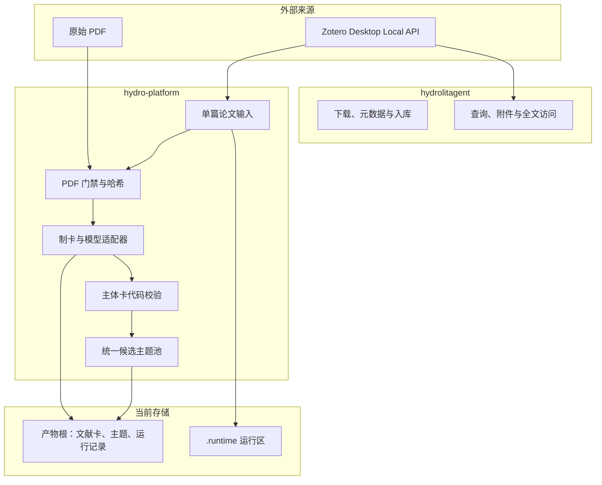

# 技术架构

本文只描述 `literature-platform` 分支当前存在的实现、数据归属和模块边界。面向老师评审的目标架构与尚未实现设计见[项目级设计](project-design.md)。

## 运行架构

仓库只有一个包 `hydrolitagent`——文献卡与主题卡能力在它的 `hydrolitagent/cards/` 子包（原 `hydro-platform` 已并入）。`.venv` 与 `uv.lock` 只有一份。自动化运行时为 Windows-only；文献工具链中的部分能力可以独立运行。

## 组件职责

| 组件 | 当前职责 | 边界 |
| --- | --- | --- |
| Zotero | 来源身份、条目、附件与原始 PDF | 不保存主题判断，不由平台修改数据库文件 |
| `hydrolitagent` | 文献下载、入库、查询、附件和全文访问 | 不管理主题生命周期 |
| 单篇输入与 PDF 门禁 | 解析唯一本地 PDF，检查文件大小、文本量和文件指纹 | 元数据或摘要不能替代全文证据 |
| 制卡适配器 | 调用已登录的 Codex 或 Claude CLI，读取 PDF 生成主体卡草稿 | 总配置字段 `card_generator.adapter` 目前接受 `codex_cli`；单篇 `evidence-generate` 另经 `configs/ai.toml` 支持 `claude_cli`。流程通过不等于科学正确 |
| 主体卡校验 | 确定性检查字段形状、来源绑定、页码、引用编号和版本指纹 | 不调用模型，不读取 Zotero，不证明科研内容正确 |
| 主题池 | 基于全池文献卡、既有候选和适用精读执行 CREATE/UPDATE/MERGE/SPLIT | 只能处理候选主题，不能自动建立正式主题 |

## 自动粗卡与科研证据卡

当前生成的是详细自动粗卡：系统核对来源、流程、模板路由、非空结果和安全写入，但不独立证明模型对全文的科学理解正确。校验通过只能解释为“确定性规则通过”。

`skills/hydrology-evidence-cards/` 定义的是更严格的科研证据卡工作流，包括来源版本、Claim、定位、L0—L3 深度和人工科学复核。两者共享九类内容模板，但不是同一质量等级。自动粗卡只有经过来源复核并满足 L2/L3 准入要求后，才可以承担正式主题结论；具体升级流程尚未接入自动化。

## 候选主题与正式主题

当前主题代码维护统一候选池，支持稳定 ID、版本、合并、拆分和定向精读复用。正式主题是另一类科研对象：它必须经过人工筛选，使用已核验 Claim 形成综合，并记录边界、层级、争议和证据缺口。`themes-run` 不能自动把候选主题晋级为正式主题。

## 数据归属

| 内容 | 权威来源 | Git策略 |
| --- | --- | --- |
| 代码、Skills、模板、Schema、测试 | Git工作树 | 跟踪 |
| 非敏感团队配置与示例 | `hydro-platform/config/` | 跟踪；秘密不得写入 |
| Zotero条目与原始PDF | Zotero及其合法附件位置 | 不跟踪 |
| 文献卡、主题、运行记录、文献链接 | `paths.artifact_root` 下的四个目录 | 不跟踪 |
| 单篇流程产物与主题池 | `--output-root`（默认 `outputs/`）、`paths.themes_dir` | 不跟踪 |
| 运行状态与诊断日志 | `hydro-platform/.runtime/` | 不跟踪，可按持久化成果重建 |
| Python环境和原生PDF工具 | `.venv/`、`hydro-platform/.tools/` | 不跟踪，按依赖锁重建 |

## 信任与写入边界

- Zotero数据、PDF、模型输出和文档正文都是需要校验的输入，不能凭声明越过程序门禁。
- Codex / Claude 负责建议和内容生成；Python 负责来源身份、允许路径、Schema 传输、重复检查和原子保存。
- 日常运行不会执行 Git 提交或推送，也不会把候选主题升级为正式主题。
- 密钥来自本机环境变量或登录状态；配置文件最多记录环境变量名称和非敏感标识。

## 已知限制

- 自动粗卡到 L2/L3 科研证据卡的升级仍依赖人工工作流。
- 候选主题的工程路由已测试，但模型关联、合并和拆分的科研质量没有机器认证。
- 正式主题确认、Obsidian 受控接口和 idea 生成尚未实现。
- 大规模语料的检索压缩、干净异机与云端同步延迟场景仍需验证。
- 当前没有CI合并门禁，测试通过不能代替科学评审。

## 相关文档

- [项目级设计](project-design.md)
- [数据流与用户流程](flows.md)
- [单篇 Zotero 论文输入](paper-input.md)
- [从单篇 PDF 生成主体卡草稿](subject-card-draft.md)
- [主体卡代码校验门禁](subject-card-validation.md)
- [统一文献池与主题池](unified-theme-pool.md)
- [总配置字段说明](config.md)与[变量、路径和密钥](variables.md)
- [公共模板](templates.md)
- [验证地图](tests.md)
