# 技术架构

本文只描述 `literature-platform` 分支当前存在的实现、数据归属和模块边界。面向老师评审的目标架构与尚未实现设计见[项目级设计](project-design.md)。

## 运行架构

```mermaid
flowchart TB
    subgraph Sources[外部来源]
        ZD[Zotero Desktop Local API]
        ZW[Zotero Web API]
        PDF[原始 PDF]
    end

    subgraph Toolkit[hydrolitagent]
        INGEST[下载、元数据与入库]
        QUERY[查询、附件与全文访问]
    end

    subgraph Platform[hydro-platform]
        SCAN[增量扫描与对账]
        GATE[PDF 门禁与哈希]
        TASKS[任务、锁与恢复]
        CARD[Codex 单 Agent 制卡]
        THEME[统一候选主题池]
        REPORT[活动与日报]
    end

    subgraph Storage[本机或指定共享位置]
        ARTIFACTS[artifact_root]
        RUNTIME[.runtime]
    end

    ZW --> INGEST
    ZD --> QUERY
    ZD --> SCAN
    PDF --> GATE
    SCAN --> GATE --> TASKS --> CARD --> THEME
    TASKS --> REPORT
    CARD --> ARTIFACTS
    THEME --> ARTIFACTS
    REPORT --> ARTIFACTS
    SCAN --> RUNTIME
    TASKS --> RUNTIME
```

仓库是一个 uv workspace：根包 `hydrolitagent` 与成员包 `hydro-platform` 共用仓库根的 `.venv` 和 `uv.lock`。自动化运行时为 Windows-only；文献工具链中的部分能力可以独立运行。

## 组件职责

| 组件 | 当前职责 | 边界 |
| --- | --- | --- |
| Zotero | 来源身份、条目、附件与原始 PDF | 不保存主题判断，不由平台修改数据库文件 |
| `hydrolitagent` | 文献下载、入库、查询、附件和全文访问 | 不管理正式主题生命周期 |
| 扫描与PDF门禁 | 发现新增、检查父条目/附件、文本量和文件指纹 | 元数据或摘要不能替代全文证据 |
| 任务与发布 | 任务状态、租约、锁、幂等、恢复和多文件安全保存 | 文件夹存在或单一完成标记不能证明结果完整 |
| 制卡适配器 | 调用已登录的Codex CLI，按九类模板之一生成详细自动粗卡 | 当前只支持`codex_cli`；流程通过不等于科学正确 |
| 主题池 | 基于全池粗卡、既有候选和适用精读执行CREATE/UPDATE/MERGE/SPLIT | 只能处理候选主题，不能自动建立正式主题 |
| 活动与日报 | 记录关键事件并生成非AI日报 | 不代表科研质量评审 |
| Obsidian Adapter | 尚未实现 | 目标接口见[项目级设计](project-design.md) |

## 自动粗卡与科研证据卡

当前自动化产生的是详细自动粗卡：系统核对来源、流程、模板路由、非空结果和安全写入，但不独立证明模型对全文的科学理解正确。`PROCESS_VALIDATED`只能解释为“处理流程完成”。

`skills/hydrology-evidence-cards/`定义的是更严格的科研证据卡工作流，包括来源版本、Claim、定位、L0—L3深度和人工科学复核。两者共享九类内容模板，但不是同一质量等级。自动粗卡只有经过来源复核并满足L2/L3准入要求后，才可以承担正式主题结论；具体升级流程尚未接入自动化。

## 候选主题与正式主题

当前主题代码维护统一候选池，支持稳定ID、版本、合并、拆分和定向精读复用。正式主题是另一类科研对象：它必须经过人工筛选，使用已核验Claim形成综合，并记录边界、层级、争议和证据缺口。`run-once`和`themes-run`都不能自动把候选主题晋级为正式主题。

## 数据归属

| 内容 | 权威来源 | Git策略 |
| --- | --- | --- |
| 代码、Skills、模板、Schema、测试 | Git工作树 | 跟踪 |
| 非敏感团队配置与示例 | `hydro-platform/config/` | 跟踪；秘密不得写入 |
| Zotero条目与原始PDF | Zotero及其合法附件位置 | 不跟踪 |
| 证据包、自动主题池、活动和日报 | 配置解析出的运行产物目录 | 不跟踪 |
| 证据卡、正式主题、运行记录、文献链接 | `paths.artifact_root` | 不跟踪，由操作者或团队共享位置管理 |
| 快照、任务、锁、草稿和诊断日志 | `hydro-platform/.runtime/` | 不跟踪，可按持久化成果重建 |
| Python环境和原生PDF工具 | `.venv/`、`hydro-platform/.tools/` | 不跟踪，按依赖锁重建 |

## 信任与写入边界

- Zotero数据、PDF、模型输出和文档正文都是需要校验的输入，不能凭声明越过程序门禁。
- Codex负责建议和内容生成；Python负责来源身份、允许路径、任务状态、Schema传输、重复检查和原子保存。
- 日常运行不会执行Git提交或推送，也不会把候选主题升级为正式主题。
- 当前锁和写入保护面向一台指定制卡机，不是多台电脑的分布式锁。
- 密钥来自本机环境变量或登录状态；配置文件最多记录环境变量名称和非敏感标识。

## 已知限制

- Obsidian受控接口、正式主题确认和idea生成尚未实现。
- 自动粗卡到L2/L3科研证据卡的升级仍依赖人工工作流。
- 候选主题的工程路由已测试，但模型关联、合并和拆分的科研质量没有机器认证。
- 大规模语料的检索压缩、干净异机、关机/登录及云端同步延迟场景仍需验证。
- 当前没有CI合并门禁，测试通过不能代替科学评审。

## 相关文档

- [项目级设计](project-design.md)
- [数据流与用户流程](flows.md)
- [自动化边界](automation.md)
- [配置](config.md)与[变量、路径和密钥](variables.md)
- [运行一轮](run-once.md)与[工作站设置](workstation-setup.md)
- [模板资产](templates.md)与[统一主题池](unified-theme-pool.md)
- [权限与数据归属](permissions.md)与[验证地图](tests.md)

