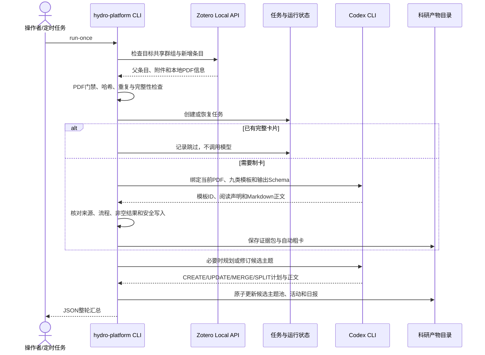
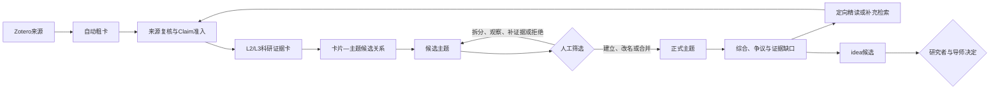

# 数据流与用户流程

本文说明当前运行链路及目标中的人工科研闭环。技术模块见[技术架构](architecture.md)，完整目标设计见[项目级设计](project-design.md)。

## 当前自动化数据流

这条链路已经实现。模型失败、来源变化、PDF不完整或写入冲突时，程序保留已有结果和诊断信息，不把半成品宣布为完成。相同输入且已有完整成果时应复用，不重复调用模型。

## 目标科研工作流

自动粗卡是阅读和发现材料，不自动取得L2/L3资格。进入正式主题的承重结论必须回链到经过来源核对的Claim。候选主题可以由模型形成和演化，但只有带人员、时间和理由的人工决定才能建立、改名、合并或拆分正式主题。

## 用户流程

### 首次使用

1. 操作者准备Zotero、Codex CLI、受支持的Python和可访问的PDF。
2. 克隆仓库并执行`uv sync --all-packages`。
3. 配置Zotero群组、模型、科研产物根、环境和调度，执行`preflight`与`generator-preflight`。
4. 运行一次`run-once --json`，核对实际读取的群组、PDF、产物路径和整轮结果。

### 日常研究

1. 研究者在Codex中提出处理新增文献、查看主题证据或寻找缺口的任务。
2. 系统处理Zotero新增来源，生成或复用自动粗卡与候选主题。
3. 研究者在Obsidian中阅读结果，检查来源、主题边界、代表证据和异议。
4. 研究者通过Codex记录主题决定；系统只执行被允许的变更。
5. 正式主题形成综合与补证据请求，必要时返回原文复核或补充检索。
6. 主题成熟后生成idea候选，由研究者和导师决定是否采用。

当前已实现前两步及Markdown结果查看。Obsidian受控搜索与写入、正式主题决定命令和idea模块属于目标设计，尚未进入当前运行命令。

## 人工与自动化边界

| 动作 | 自动化是否可以直接执行 | 约束 |
| --- | --- | --- |
| 扫描Zotero、检查PDF、创建任务 | 可以 | 只访问配置指定的群组和路径 |
| 生成自动粗卡 | 可以 | 保留来源身份和流程记录，不宣称科学核验 |
| 创建或修订候选主题 | 可以 | 不能修改正式主题，不得删除历史 |
| 建立、合并、拆分正式主题 | 不可以 | 必须有人工决定记录 |
| 修改已核验Claim | 不可以直接执行 | 需要重新打开来源并记录修订依据 |
| 创建idea候选 | 目标中可以建议 | 必须回链正式主题和Claim，不能自动认定创新 |
| 写入Obsidian正式知识区 | 尚未实现 | 第一阶段只读；后续限定目录并做冲突检测 |
| 提交或推送Git | 不可以 | 只有用户明确要求时由维护者执行 |

## 失败与恢复

- Zotero未就绪：有限等待或启动后仍不可用则停止，不伪造空扫描成功。
- PDF未通过门禁：保留等待或阻塞状态，附件补齐后再次对账。
- Codex不可用：按配置执行有限重试和冷却，保存脱敏诊断，不无限调用。
- 产物发生人工修改或来源冲突：停止覆盖，要求人工判断。
- `.runtime`丢失：根据Zotero与完整持久化成果重建；未保存草稿不能凭空恢复。
- 主题处理部分失败：旧候选继续有效，全部替代结果准备完成后才发布新版本。

