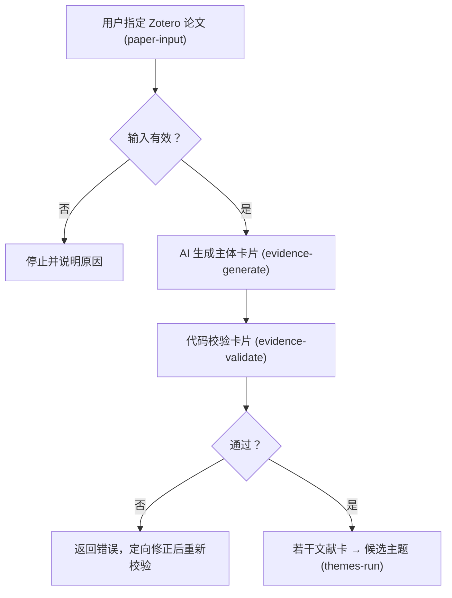

# 文献研究平台

本平台以你自己的 Zotero 文献库为来源，把一篇论文变成一张可校验的文献卡，再把若干文献卡组织成持续演化的主题卡。Codex 或 Claude CLI 负责内容提炼，Python 负责确定性的门禁、校验与安全写入。Git 只保存可复现的代码、配置、模板、测试和文档。

本页只说明“平台是什么、现在做到哪里、从哪里读起”。面向老师评审的目标设计见[项目级设计](project-design.md)，技术实现、字段和运行步骤分别由专项文档维护。

## 最小核心：五条命令

| 阶段 | 命令 | 做什么 |
| --- | --- | --- |
| 输入 | `paper-input` | 按题名搜索候选，或按条目 Key 检查单篇 Zotero 论文，得到 READY 输入记录 |
| 生成 | `evidence-generate` | 读取该篇 PDF 的正文，调用所选模型生成主体卡草稿 |
| 校验 | `evidence-validate` | 离线校验草稿并保存校验记录，不调用模型、不正式发布 |
| 主题 | `themes-run` | 以若干通过校验的文献卡为输入，生成候选主题、定向精读并回填修订 |
| 自查 | `ai-config` | 查看模型选择与精读产物根，不运行模型 |

命令一律从仓库根执行，完整清单见 `uv run hydrolitagent cards --help`。

## 从这里开始

| 你想了解什么 | 阅读入口 |
| --- | --- |
| 单篇论文从输入到校验的完整命令行流程 | [单篇论文命令行流程](single-paper-quickstart.md) |
| 单篇 Zotero 论文输入 | [单篇 Zotero 论文输入](paper-input.md) |
| 主体卡草稿生成 | [从单篇 PDF 生成主体卡草稿](subject-card-draft.md) |
| 主体卡代码校验 | [主体卡代码校验门禁](subject-card-validation.md) |
| 主题池：候选主题的演化与版本 | [统一文献池与主题池](unified-theme-pool.md) |
| 技术架构、数据归属与模块边界 | [技术架构](architecture.md) |
| 数据流、用户流程与失败处理 | [数据流与用户流程](flows.md) |
| 配置字段、路径与密钥边界 | [总配置字段说明](config.md) · [变量与密钥](variables.md) |
| 证据卡与主题模板 | [公共模板](templates.md) |
| 验证与测试覆盖 | [验证地图](tests.md) |
| 科研工作流（人读证据卡与主题综合） | [科研工作流](research-platform-overview.md) |
| 面向评审的总体设计 | [项目级设计](project-design.md) |

## 单篇核心流程

## 平台边界

- Zotero 条目负责论文身份，条目中的 PDF 负责正文内容。
- 输入论文必须已经有可读取的全文；不满足时停止并说明原因。
- 生成调用所选 CLI（Codex 或 Claude）；校验是纯代码检查，不调用模型。
- 通过校验只表示确定性规则通过，不证明科研内容正确。
- 正式主题必须经人工确认，`themes-run` 只产出候选，不自动晋级。

## 存储与版本边界

单篇流程的产物写入 `--output-root`（默认仓库 `outputs/`）；主题池写入 `paths.themes_dir`。以下内容进入 Git：

- 代码、Skills、模板、Schema 和测试；
- 项目文档、依赖锁和非敏感团队配置；
- 不包含私人路径、账号和密钥的示例。

以下内容不进入 Git：

- Zotero 数据库、原始 PDF 和账号凭据；
- `hydro-platform/.runtime/`、`.venv/` 和项目内原生工具；
- 实际生成的文献卡、主题和运行记录。

程序不会自动提交或推送 Git。需要共享科研产物时，应通过团队另行确认的共享位置和权限策略处理，不能把本地保存写成已经完成远端备份。

## 文档维护规则

当前实现与目标设计必须分开；旧方案、阶段验收和演示讲稿由 Git 历史保存，不继续占用正式导航。模板的可执行版本以 `skills/` 和 `hydro-platform/templates/` 为准，文档只说明用途、关系和版本来源，不再维护第三份模板副本。
