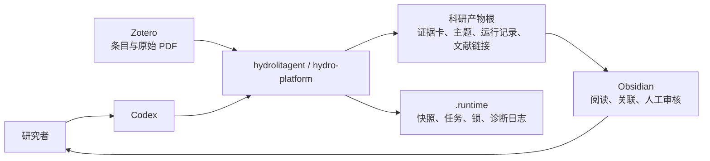

# 文献研究平台

本平台以 Zotero 为文献与原始 PDF 的事实来源，把新增文献转化为可追溯的证据卡、候选主题和研究记录。Codex 是主要交互与任务编排入口；Obsidian 是目标中的阅读、导航和人工审核空间。

本页只负责说明“平台是什么、现在做到哪里、下一步去哪里”。项目级目标设计见[项目级设计](project-design.md)，技术实现、配置和运行步骤分别由专项文档维护。

## 从这里开始

| 你想了解什么 | 阅读入口 |
| --- | --- |
| 老师要求的总体架构、数据流、用户流程、模块边界、配置、运行和模板关系 | [项目级设计](project-design.md) |
| 当前代码如何组成、数据归谁管理 | [技术架构](architecture.md) |
| 一篇文献怎样流转，人工在哪些位置介入 | [数据流与用户流程](flows.md) |
| 第一次安装和换电脑 | [工作站设置](workstation-setup.md) |
| 日常处理 Zotero 新增文献 | [运行一轮](run-once.md) |
| 配置字段、路径与密钥边界 | [配置](config.md) · [变量与密钥](variables.md) |
| 证据卡和主题模板 | [模板资产](templates.md) · [统一主题池](unified-theme-pool.md) |
| 自动化权限、测试与已知限制 | [自动化边界](automation.md) · [验证地图](tests.md) |

## 平台全貌

Zotero 保存来源；Python 程序负责确定性的扫描、门禁、状态和安全写入；Codex负责内容提炼与主题建议；研究者负责正式主题和 idea 的最终判断。Git只保存可复现的代码与规则，不保存实际科研产物。

## 当前能力与目标设计

| 能力 | 当前边界 | 下一步设计 |
| --- | --- | --- |
| Zotero 新增检测与 PDF 门禁 | 已实现共享群组扫描、去重、全文可用性检查和来源指纹 | 继续验证云端同步延迟与异机恢复 |
| 自动证据卡 | 已实现单 Agent、九类模板、证据包和失败恢复；`PROCESS_VALIDATED`只表示流程通过 | 明确自动粗卡升级为 L2/L3 科研证据卡的条件 |
| 候选主题 | 已实现统一主题池、候选更新、合并、拆分和精读复用 | 把自动候选接入正式的人工筛选门 |
| 正式主题 | 规则和模板已有，普通运行不会自动建立 | 实现人工决定记录、层级、关系和版本操作 |
| Obsidian | Markdown 产物可直接阅读，正式工具集成未实现 | 文件型 MCP 先只读，CLI负责打开与差异复核，REST API按需启用 |
| research idea | 当前不生成 | 仅从正式主题、已核验 Claim 和明确缺口生成候选，再由研究者与导师判断 |

## 存储与版本边界

`paths.artifact_root` 是证据卡、主题、运行记录和文献链接的共同父目录，可以指向本机或外部共享位置。四类科研产物必须保持同根，保证相互引用有效。

以下内容进入 Git：

- 代码、Skills、模板、Schema和测试；
- 项目文档、依赖锁和非敏感团队配置；
- 不包含私人路径、账号和密钥的示例。

以下内容不进入 Git：

- Zotero数据库、原始PDF和账号凭据；
- `hydro-platform/.runtime/`、`.venv/`和项目内原生工具；
- `evidence-packs/`、`themes/`、`activity/`、`reports/`及`artifact_root`下的实际科研产物。

程序不会自动提交或推送Git。需要共享科研产物时，应通过团队另行确认的共享位置和权限策略处理，不能把本地保存写成已经完成远端备份。

## 文档维护规则

当前规则只在一个地方定义，其他页面通过链接引用，不复制整段内容。当前实现与目标设计必须分开；旧方案、阶段验收和演示讲稿由Git历史保存，不继续占用正式导航。模板的可执行版本以`skills/`和`hydro-platform/templates/`为准，文档只说明用途、关系和版本来源，不再维护第三份模板副本。

