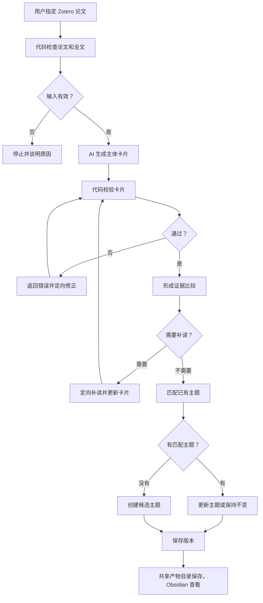

# 文献平台核心 MVP PRD

- 状态：导师审阅稿 v1.0
- 对应：[Issue #20](https://github.com/iHeadWater/mylibrary/issues/20)
- 日期：2026-09-15
- 说明：本稿尚未经过导师确认，不代表 Issue #20 已完成或可以关闭。

## 1. 产品简介

文献平台帮助课题组把新论文变成可以查证和共享的研究知识。

用户从 Zotero 指定一篇论文。AI 生成主体卡片、证据比较和主题内容，代码负责校验。卡片和主题保存到共享产物目录，并通过 Obsidian 查看。

## 2. 要解决的问题

平台已有很多功能，但最核心的流程还没有被完整证明：

> 一篇新论文能否稳定地变成一张合格卡片，并形成或更新一个研究主题？

当前问题是：

- 卡片、证据和主题之间的关系不够清楚。
- 不合格内容缺少统一的代码门禁。
- 人工逐篇核验无法处理未来的大量论文。
- 外围功能过多，分散了开发重点。

本轮先完成核心流程，不继续扩大功能范围。

## 3. 用户与目标

主要用户是课题组中阅读和整理文献的研究者。

用户只做两件事：

1. 在 Zotero 中选择一篇论文。
2. 启动处理。

之后的制卡、校验、证据比较和主题处理由系统自动完成。

MVP 要证明：

- 一篇论文可以跑通完整流程。
- 不合格卡片会被代码拦截。
- 新论文可以形成候选主题或更新已有主题。
- 产物可以追溯、共享和复现。

## 4. MVP 范围

### 本轮要做

- 从一个指定的 Zotero 条目读取论文。
- 生成一份主体卡片。
- 用代码校验卡片。
- 校验失败后返回原因并自动修正。
- 根据卡片形成证据比较。
- 必要时定向补读论文。
- 创建候选主题或更新已有主题。
- 保存旧版本。
- 将卡片和主题保存到共享产物目录，并通过 Obsidian 查看。
- 用两篇真实论文完成验收。

### 本轮不做

- 无全文处理、PDF 下载和 OCR。
- Zotero 自动扫描和批量处理。
- 最终卡片模板设计。
- 独立证据数据库和证据评分。
- 复杂主题层级、合并和拆分。
- 日报、任务、活动、推荐、推送和权限系统。
- 大规模性能优化。

输入论文必须已经有可读取的全文。不满足时，系统停止并说明原因。

## 5. 核心流程

## 6. 核心规则

### 论文入口

- Zotero 条目负责论文身份。
- 条目中的 PDF 负责正文内容。
- MVP 由用户指定单篇论文，不自动扫描。

### 主体卡片

- 一篇论文只有一份主体卡片。
- 卡片只描述论文自身，不针对不同主题重复生成。
- 一张卡片可以关联多个主题。
- MVP 只规定卡片必须提供研究问题、方法、主要结果、原文依据、限制和缺失信息。
- 卡片最终模板以后单独讨论。

### 代码校验

- 卡片生成后必须经过代码校验。
- 代码检查机器可以判断的完整性、一致性、可追溯性和版本规则。
- 未通过的卡片不能进入主题流程。
- 失败时返回明确原因，由 AI 定向修正后重新校验。
- 具体检查项、错误码和重试次数由子 Issue 的 Spec 决定。
- 日常流程不增加独立 AI 审查，也不要求逐篇人工审批。

### 证据比较与补读

- 卡片通过后，系统判断新论文对具体研究问题有什么作用。
- 比较结果直接写入主题文档，不建设独立证据系统。
- 信息足够时不补读。
- 卡片遗漏了原文已有信息时，只补读缺失部分。
- 原文没有报告时，保留信息不足，不反复读取。

### 主题

- 有合适主题时，更新已有主题或记录无变化。
- 没有合适主题时，创建候选主题。
- 单篇论文形成的主题不能写成多文献共识。
- 更新主题时保留旧版本。
- 主题最终模板和复杂关系以后讨论。

### 保存与共享

- Zotero 保存论文和 PDF。
- 共享 `artifact_root` 保存卡片、主题、运行记录和历史版本；它可以配置为课题组共用的 Obsidian Vault。
- Git 仓库只保存代码、配置、skills、模板、测试和文档，不保存日常生成的研究产物。
- Obsidian 是统一阅读入口，直接读取共享产物目录。
- 具体目录和文件名由子 Issue 的 Spec 决定。

### 代码归位

- 当前 MVP 建议继续在 `hydrolitagent/cards/` 内收敛实现，复用已有制卡、校验、主题和版本能力。
- MVP 只保留一个“处理指定 Zotero 条目”的主入口；扫描、任务、活动、日报和调度不进入本轮流程。
- skills 继续放在 `skills/` 下。
- Issue #20 提出了统一归入 `hydrolitagent/` 的要求，但当前仓库把两个包设计为独立职责。是否合并需要导师确认，不在本轮直接搬迁或维护两套实现。
- 如果确认必须统一到 `hydrolitagent/`，应另开迁移 Issue，明确复用、冲突、删除旧入口和回归测试范围。

## 7. MVP 验收

使用两篇真实论文：

- 第一篇创建候选主题。
- 第二篇与第一篇比较，并更新主题或记录无变化。

需要通过四个场景：

1. **完整流程**：从 Zotero 论文生成卡片和主题，并能在 Obsidian 中打开。
2. **错误修正**：代码拦截不合格卡片，AI 修正后重新校验。
3. **主题更新**：第二篇论文进入后，主题发生更新或明确保持不变，旧版本仍然存在。
4. **共享复现**：另一名同学取得相同 Git 版本和共享产物目录后，可以找到产物，并按相同配置重新运行。

自动测试通过不能单独代表 MVP 完成。还要提供两篇真实论文产生的卡片、主题和运行结果。

## 8. 风险与待确认事项

### 风险

- 代码通过不代表科研理解一定正确。
- AI 修正可能失败，因此必须有停止条件。
- 两篇论文只能证明最小流程，不能证明大规模效果。

人工只在 MVP 验收时抽查真实样例，不进入日常逐篇流程。

### 需要导师确认

- 日常流程使用代码校验，不要求逐篇人工确认。
- 无全文、OCR 和材料登记不属于 MVP。
- 复杂主题关系、合并和拆分不属于核心 MVP。
- 本轮只定义卡片最低内容，不确定最终模板。
- 两篇论文用于最小验收，4—6 篇试测放到后续。
- MVP 实现暂留 `hydro-platform`，还是迁移到 `hydrolitagent/`。

## 9. 子 Issue 建议

1. 从指定 Zotero 条目读取论文。
2. 生成唯一的主体卡片。
3. 实现代码校验与自动修正。
4. 实现证据比较与最小补读。
5. 创建或更新候选主题。
6. 保存、共享与复现。
7. 使用两篇真实论文进行联合验收。
8. 完成 37 个模块和 28 个命令的处置清单（本评审稿 2026-09-15 快照；模块与命令已随实现继续增长，现行数量以 `uv run hydrolitagent cards --help` 与代码为准）。

各子 Issue 可以使用固定输入独立验收，但真实流程存在先后依赖。

Issue #20 只有在 PRD、汇报 PPT、子 Issue、模块处置清单、真实样例和复现结果全部确认后，才能关闭。
