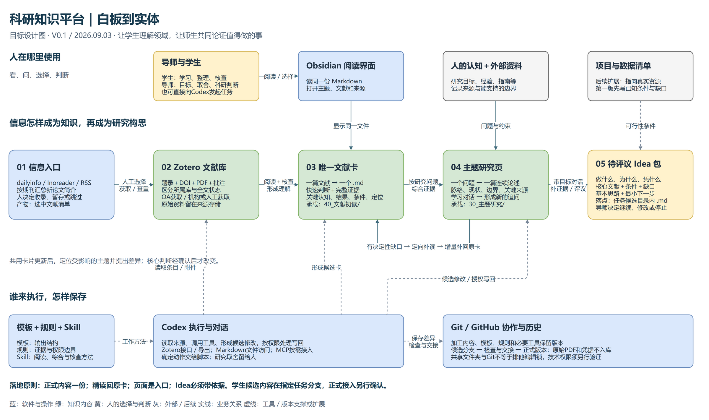

# 科研知识平台：从文献到主题，再到值得做的事

产品文档 V0.1｜2026年9月3日｜供导师和两位建设同学讨论

**产品定位：让学生通过有来源的主题页进入一个研究领域，让导师和学生在同一份知识基础上对话，把有价值的问题整理成可以评议的 Idea 包。**

本稿把会议白板落到软件、文件、页面、操作和验收。会议要求是设计输入；文中的样本数、时间指标、交接方法和任务拆分是本稿建议，尚未成为团队规则。会议里的仓库迁移、邀请、清理和共享工具讨论，不视为本次执行命令。

先读第1—2节理解产品与实体图；第3—6节定义实现要求，第4.4节提供可以直接使用的只读操作样例；第7—8节用于验收和分工；第9节列出上线前需要裁决的事项。文末附会议时间定位和外部实践对照。

> GitHub 发布说明：本稿以个人 Obsidian 平台为设计参照，目录名及本地规则不代表已在 mylibrary 部署。团队执行先读[仓库兼容说明](仓库兼容说明.md)，任务及实际进度见[执行包入口](README.md)。下述“尚未创建 Issue”描述原稿形成时状态；本次已按用户后续要求建立任务，详见[同步索引](GitHub同步索引.md)。

## 1. 先把要解决的问题说清楚

### 1.1 两个用户、两个收益

**学生是第一使用者。** 面对几十篇文献，困难是看不出领域在解决什么、方法为什么演进、哪些结果可以比较，以及下一步该读哪里。学生应该能从一篇连续可读的主题论述进入，通过追问定位到具体文献和原文，而不必先猜文件名。

**导师是科研判断者。** 导师需要知道学生理解到了哪里、主题的主要认识及其依据是什么、哪个问题可能值得投入。导师应把精力用在研究取舍，而不是逐个解释软件、处理文件和修补格式。

初读整理同学和同伴检查同学共同建设内容；同一人可在不同任务中轮换角色。平台维护工作负责连接工具、检查文件、保存历史，不代替导师决定科研方向。

### 1.2 从白板提炼出的三次判断

| 所处位置 | 人真正要回答的问题 | 留下的东西 |
| --- | --- | --- |
| 信息入口 → 文献库 | 这篇值得收进来、进一步看吗？ | 一条有身份和来源的文献记录 |
| 文献 → 知识体系 | 它增加了什么认识，能在哪些条件下使用？ | 唯一文献卡，以及引用它的主题论述 |
| 知识体系 → Idea | 有什么值得做，为什么做、为什么现在做、为什么我们能做？ | 有核心依据和缺口的 Idea 包 |

自动化应当减少搜索、搬运和重复整理，把这三次判断需要的材料准备好。RSS一句话简介用于挑选；文献卡保存可复用理解；主题页组织领域认识；Idea 包组织研究意图。这四种东西不能互相替代。

### 1.3 第一版只验证一个完整使用闭环

会议给出的第一版目标是“快速进入科研状态＋产生有价值的 Idea”，实验迭代与论文写作在后续。为了先验证产品，本稿建议首轮使用已有候选材料中的一个小集合，完成：

**6—8篇有可用原文的来源 → 1个可读主题页 → 1次带来源的学习对话 → 1次按问题补读 → 0—2个待评议 Idea 包 → 换电脑复现。**

这是拟议演示规模，不是批准扩充正式初读的数量。先从已有材料择样；不足时缩小演示范围并标明缺口，不用新建空卡凑数。会议希望看到1—2个不错的想法；产品必须允许“尚无可信想法”，并说明卡在哪里。没有 Idea 不等于工具链失败，但不能据此宣称选题价值已验证。

在导师明确开启下一轮试运行以前，54条来源任务继续执行原有中性发现要求，不能据本稿按导师预期重新分类。第4.4节先使用既有正式主题只读演示，不改学生交付。

暂不建设全自动科研系统、完整数据资产库、大规模全库重读或统一所有人的细粒度主题树。第一版接受人工选择文献和人工发起任务，先打通内容质量与交接。

## 2. 把白板变成可以找到实体的图

图中实线表示资料进入、内容形成或人发起使用；虚线表示工具调用、版本支撑或后续扩展。**这是一张目标设计图，不能据此认为所有连线已经接通。** 蓝色是软件与操作入口，绿色是内容，黄色是人工判断，灰色是外部资料与后续能力。原始资料保留在其存储位置，通过链接支撑知识文件。

### 2.1 白板要素与实体对应

| 白板上的词或图形 | 在产品中对应什么 | 人实际看到或操作什么 |
| --- | --- | --- |
| dailyinfo、Inoreader、RSS | 信息订阅与摘要入口 | 按期刊排列的新论文简介、来源链接、收录选择 |
| taste／人工选择 | 人的兴趣与研究判断 | 选择收录、暂存、跳过；AI解释供参考 |
| OA／Non-OA／自动下载 | 全文获取任务 | 已取得、待机构访问、待人工提供、获取失败 |
| Zotero／文献库 | 文献题录与附件管理软件 | 条目、DOI、集合、标签、PDF、原始批注 |
| 卡片、template | 一个文献对应一份结构化Markdown | 快速判断、完整证据、原文定位、后续补读 |
| Obsidian、文件连接、主题 | 同一知识文件夹的阅读界面 | 文献卡、主题页、关联链接、变化说明 |
| Codex、MCP、Skill | 执行任务的AI客户端、连接方式与工作方法 | “解释这个主题”“核对这条判断”“提出修改” |
| 人的知识＋外部资料 | 研究目标、经验、工程问题、指南和数据说明 | 本轮关注问题、约束、来源链接及适用边界 |
| dir／库／存储图形 | 文件与资料的实际保存位置 | 哪个库、哪个文件夹、谁可读写、如何恢复 |
| Git、共享文件夹 | 知识文件的版本与协作安排 | 候选修改、差异、交接记录、正式版本 |
| Idea／值得做的事 | 可供导师评议的研究构思包 | 问题、理由、核心文献、可用条件、缺口、最小下一步 |

白板顶部圆柱中的字母、右侧个别手写词不够清晰，不强行认定成某种数据库或专有模块。“外部资料”与存储的作用由会议00:44:49—00:49:17交叉解释。dailyinfo名称按白板归一；转写中的多种软件同音词，仅在上下文明确时归一为Zotero、Obsidian、Codex、Git和Skill。

### 2.2 实体存在哪里

现有平台已有可用的内容目录，第一版建议优先复用。下表描述承载关系，不要求迁移当前文件。

| 内容或能力 | 对应载体 | 进入版本管理的内容 |
| --- | --- | --- |
| 文献原始记录与PDF | 指定Zotero库及附件存储 | 引用身份和定位；PDF、数据库不放知识仓库 |
| 正式文献卡 | `40_文献初读/`，每篇一个Markdown | 加工后的认识、证据位置、补读和修订 |
| 正式主题页 | `30_主题研究/`，每主题一个Markdown | 领域脉络、条件化认识、来源关系 |
| 方向与导航 | `20_研究方向/`、`00_我的工作台/` | 层级和入口；主题正文仍在原页 |
| 尚未批准的学生内容 | 现有学生任务指定的候选目录与分支 | 候选卡、候选主题和评议材料 |
| 研究构思 | 候选阶段写在任务候选材料；正式线索按既有主题规则保存 | Idea正文保持一份，其余位置仅链接 |
| 模板、规则、工具 | `70_模板与配置/`、`80_工具与Skills/`及既有规则 | 可复制模板、说明、必要脚本与版本 |
| 外部报告和项目原资料 | 原项目或另行指定的受控资料位置 | 来源清单与使用边界；不复制未公开正文 |

同一篇文献即使被多人使用，也只指向一份正式文献卡。每人可以有工作分支和阅读视角，但不能把私人副本变成第二套正式内容。OneDrive只是会议提到的原始资料共享选项，服务、账号和目录尚待确定。

## 3. 三种内容对象，分别做到什么程度

### 3.1 文献卡：让下一步综合有东西可用

**文献卡的质量取决于能否支撑主题理解。** 只有摘要翻译、标签和几句泛泛结论的卡片，无法承担这一任务。卡片应同时保留关键认知、重要结果、可比较条件和可迁移边界。

首屏回答五件事：研究问题；实际新增认识；决定性结果；最大适用边界；与当前问题的关系。下方展开证据档案，保留数据和方法链、验证方式、作者解释、平台判断、原文位置和待核验内容。初读和补读是同一文件的内容增量，不是两张卡。

| 最少需要的内容 | 为什么必须保留 |
| --- | --- |
| 身份、来源、读到的范围 | 防止同名、重复、摘要冒充全文 |
| 研究问题与已有研究缺口 | 解释作者究竟要解决什么 |
| 对象、地点、时段、尺度、输入与方法 | 判断两篇研究是否可比较、方法能否迁移 |
| 核心结果及原文位置 | 主题判断能够回到具体依据 |
| 作者解释与我们的判断 | 防止推断被写成作者结论 |
| 局限、失败情景与未解决问题 | 避免只保留有利结论 |
| 主题关联理由与补读记录 | 说明这篇文献在知识体系中的实际作用 |

本表是产品最低语义要求，不是另一个生产模板。正式论文继续使用已登记的八部分骨架与两层阅读方式。研究论文、综述和方法论文允许不同展开：综述重点看覆盖与综合逻辑；研究论文重点看数据、验证和结果；方法论文重点看假设、输入输出、对照与迁移条件。非论文来源不硬套论文模板。

会议讨论过自定义文件后缀。本稿建议第一版保留`.md`，用少量身份字段、真实章节标题和模板版本识别对象。自定义后缀只有在出现Markdown不能表达的实际需求时再考虑。

### 3.2 主题页：一篇能帮助入门的研究论述

**主题围绕人的研究问题组织文献。** 导师先给关注范围和使用目的，AI从来源提出组织方式，人再修正。相同文献可以因使用目的不同而出现不同阅读重点；这不要求所有团队成员采用完全相同的细分粒度。

主题页应按读者的理解顺序展开：

1. 这个领域在解决什么，为什么重要，本文包含和不包含什么。
2. 研究路线怎样发展，关键转变由哪些证据推动。
3. 主要方法或解释分别解决什么，各自适用在什么条件。
4. 当前较稳固的认识、仍有争议的地方和证据不足的位置。
5. 哪些文献是入门、代表性、最新进展或进一步理解所必需的。
6. 当前值得追问什么，阅读者接下来可以怎样探索。

正文应连续可读，文献链接跟随具体论点出现；对照表服务于说明差别。每条关系要能回答“它支持、补充或限制了哪句话”，不能只因为关键词相同而连线。

**不把找冲突作为目标。** 只有在问题、对象、尺度、输入和评价条件具有可比性后，才讨论是否存在真正不一致。不同地区或不同任务得到不同结果，先解释适用条件；已有卡不足以判断时明确保留疑问。真实冲突可以没有，研究脉络与认识仍须讲清楚。

主题页可以产出一个有来源的综述提纲，但尚未执行系统检索时，不标成“完整系统综述”或“已经覆盖全部前沿”。

### 3.3 Idea 包：从知道什么，走到想研究什么

主题到Idea之间需要一个**带着目标反复追问的工作过程**。用户说明关注主题、研究意图和现有条件，AI对照知识中的认识和缺口，提出问题、寻找近似工作、检查前提，必要时补读，人再决定继续、改写或放下。

一个Idea包建议以1—2页主体加核心来源链接呈现，至少回答：

| 要回答的问题 | 必须交付的内容 |
| --- | --- |
| 想研究什么？ | 一个明确的研究问题，而非只有题目或关键词 |
| 为什么值得做？ | 对现有认识或实际问题可能产生什么推进 |
| 与已有工作差在哪？ | 最近似文献做过什么，当前差别依据及检索范围 |
| 为什么现在、为什么我们？ | 已知的方法、数据、场景和团队条件；未知就写未知 |
| 大致怎样检验？ | 基本思路、最小验证，以及什么结果会使设想不成立 |
| 预计得到什么？ | 预期知识或产物，不写成已经获得的结果 |
| 还缺什么？ | 关键证据、数据权限、能力和主要风险 |
| 下一步做什么？ | 一个最小动作；导师选择继续论证、补证据、修改或停止 |

一个包必须回链来源主题和核心文献。支持新颖性不足时只能写“待进一步检索”，不能宣布“首次”。指南、热点和目标期刊可以改变提问角度，不能直接证明学术价值。项目数据目录属于后续扩展；第一版也要如实写出已知资源和缺失条件，不能因为尚未建设资源模块就省略可行性。

试运行启用时，应先在任务README指定一个候选输出目录；每个候选包在该目录保存为`Idea_短题名.md`，任务汇总只链接它。导师评议结果记录在原包，未通过的包留作候选历史。若后续批准正式接入，由平台维护者按既有机会规则决定唯一宿主，并将原候选正文改为历史版本指针；不同时维护候选正文与正式正文。当前尚未指定新的Idea任务目录，因此本稿只定义包的规格，不自动开始正式迁入。

这是待评议构思的产品规格，不自动创建正式选题、基金或研究机会对象，也不展开成完整实验施工图。

## 4. 一次完整操作应该怎样发生

### 4.1 从新文献到主题页

| 步骤 | 人做什么 | 系统或AI做什么 | 看得见的结果 |
| --- | --- | --- | --- |
| 选择 | 查看新论文简介，决定收录 | 汇总来源、解释摘要 | 选中文献清单 |
| 收件 | 指定Zotero集合或交付已有PDF／DOI | 对照身份、重复项、全文状态 | 可处理与受阻条目分开 |
| 阅读 | 初读整理同学发起并检查 | 按论文类型阅读，形成有定位的卡 | 一篇一张候选文献卡 |
| 核查 | 同伴回到原文检查决定性内容 | 汇总可追溯差异和未解决项 | 修订后的卡及质量说明 |
| 综合 | 指定“想理解什么” | 从若干卡构建脉络与条件比较 | 一个可连续阅读的候选主题页 |
| 判断 | 导师检查内容是否帮助理解 | 提出局部修改，不擅自升级状态 | 可接受部分、需返工部分和理由 |

AI按单篇任务边界执行，每篇明确绑定来源与规则，再处理下一篇。若解析文本没有包含关键图表，应回到对应PDF页看图；不把文件格式选择当成证据质量保证。全文失败就留在受阻状态，不能自动生成看似完整的卡。

### 4.2 学习对话、补读、更新

用户在Obsidian打开主题页，选择一段不理解的内容，发起：“这里说的差异来自什么条件？请给我出处。”

AI先读当前主题和引用卡，返回解释、来源和边界。如果卡片足够，回答即结束。如果某个缺失的原文细节会改变当前判断，才定位最小材料补读。用户明确要求追查时，仍需记录追查什么与何时停止。

补读后，系统应展示：原来怎样写、新发现什么、建议改哪句话、哪些主题也引用这张卡。文献增量补回原卡，主题修改单独呈现。**共用文献卡更新，不等于所有主题结论立即改写。** 普通知识同步与核心判断变化，仍分别遵守现有正式写回规则。

### 4.3 从主题对话到Idea包

用户说：“从这个主题出发，在我们现有资料条件下，哪些问题值得进一步研究？”

AI展示已使用的主题、来源范围、已知资源和待核实假设；先提出有差别的问题路线，再与用户收敛。对每条保留路线，检查最近似工作、决定性前提和可验证性。关键证据缺失则回到补读环节。最终保存一个可评议的包，或者保存“目前不值得推进”的理由。

举例只用于说明操作：围绕“不同研究的结论能否迁移到我们的对象”追问，系统应先比较研究对象、数据输入与验证条件，再讨论差异是否构成值得检验的问题。本稿没有实际评审新的科学问题，不把这个演示句当作候选选题。

### 4.4 现在就能使用的只读操作样例

本例用已有内容演示“找主题—提问—回到原文—看修改建议”，不声称完整目标产品已接通。

1. 在Obsidian打开跨流域学习与无资料流域泛化（个人知识库参考路径：`30_主题研究/跨流域学习与无资料流域泛化.md`），读首屏，再打开其引用的Arsenault等文献卡（个人知识库参考路径：`40_文献初读/P-2023-0006_无资料流域LSTM与传统区域化比较.md`）。卡片结构参见当前执行骨架（个人知识库参考路径：`40_文献初读/README.md`）。
2. 在当前Codex任务中粘贴下面的交接语句。若在另一台机器，先用Codex打开知识库文件夹；语句中的路径均相对此文件夹。
3. 阅读回答，点击其中的文献卡和原文定位。若只能打开卡而不能访问PDF，应明确记录“原文入口受阻”，不把这一环节判通过。
4. 输出保留在当前对话中；若要回传演示结果，由操作者把回答及自己的复核结果保存在本产品文档同目录的`演示记录.md`。这个文件仅是演示记录，不是主题或文献的正式副本。
5. 对照“原表述—建议表述—依据—缺口”查看差异；本例到此结束。正式保存遵守第6.3节，不在本例中执行。

可复制的交接语句：

> 请只读“30_主题研究/跨流域学习与无资料流域泛化.md”和“40_文献初读/P-2023-0006_无资料流域LSTM与传统区域化比较.md”。面向刚入门的学生，解释这个主题在问什么、这篇文献起什么作用、哪些结论不能外推；给出文献页中的来源位置并说明是否直接核对原文。最后提出一个最值得追问的问题。若认为表述需要修订，在对话中列出原表述、建议表述、依据和仍缺证据；不修改文件，不生成正式Idea或新编号。

## 5. 界面和工具各做什么

### 5.1 三个主页面就能开始

| 页面 | 首屏应该显示 | 用户的主要动作 |
| --- | --- | --- |
| 文献卡 | 研究问题、决定性结果、边界、来源、当前处理状态 | 看原文、追问、纠错 |
| 主题页 | 主题边界、研究脉络、当前认识、关键来源、最近变化 | 学习提问、比较、提出研究目标 |
| Idea包 | 问题、价值、近似工作、条件、缺口、最小下一步 | 继续论证、补证据、修改、停止 |

沿用现有工作台做入口即可。编号、哈希、后台日志和连接器细节留在下层，用户不需要先学会这些才能阅读或提问。界面可以用普通Markdown、链接和可复制任务短句开始；尚未实现的按钮不能画成已可使用。

### 5.2 Obsidian负责阅读，Codex负责执行

Obsidian展示同一个知识文件夹里的内容。Codex读取指定文件和可用来源，调用工具，提出并按权限执行修改。页面旁助手可以做解释，但只有经过确认的内容才进入长期知识。

MCP是软件连接方式，不是新的数据库或知识层。Zotero涉及题录、附件及库身份时，优先通过明确的接口或导出使用其能力；普通Markdown读写可以直接使用文件夹，不为了图上有“MCP”而强制增加一层连接。具体接口须用真实样本验证。

Skill规定阅读、综合或核查的方法；模板规定输出长什么样；脚本做身份检查、去重候选、链接和版本等确定动作。三者均应可复制到另一台机器，任务依赖不能只存在于某个人的聊天记录。

第一版降级路径：没有可用的Zotero直连时，用指定集合的JSON导出；没有页面旁助手时，在Codex交付当前页面链接或路径；附件无法访问时明示缺失。连接失败不应导致知识内容无法阅读。

## 6. 共享与更新：先把“谁改哪一份”讲清楚

### 6.1 共享内容与个人工作可以并存

建议保留一份共同的正式知识内容；学生在自己的候选分支工作，导师和同伴可读、可提意见。不同人可从共同主题选择不同阅读范围，但不复制正式文献卡和已确认主题正文。未来是否允许独立的个人主题分支，待真实使用需求明确后决定。

### 6.2 “同一时段一个人改”需要交接记录

本稿建议把会议中的单人编辑想法落为一条简单记录：**当前编辑者、文件、基准版本、任务、交接状态。** 同一文件的修改由一位同学集中整理，其他人交意见；交接时先同步，再确认接手的是同一版本。

这是一种协作约定。普通文件夹、Git和CODEOWNERS本身都不是排他编辑锁。正式内容通过受控维护流程进入；如后续确实需要技术上阻断并发，再为共享服务或写入接口实现并验证权限与锁。不同文件可以各自工作，同一正式文件不得被多个自动任务同时覆盖。

### 6.3 一张卡改了，下游怎样跟上

1. 保存卡片的局部修订和原因，保留原文定位与历史。
2. 查找引用这张卡的主题，列出受到影响的具体论点。
3. 逐项判断：无需变化、补充来源，或需要修改认识。
4. 把需要判断的差异交有权决定的人，不能默认为同意。
5. 正式内容应用后，首页和其他总览再同步相应摘要；应用失败应显示仍未生效。

第一版可以人工发起这条维护流程，不必先建全库实时自动同步。联网内容只能以其实际角色使用；例如数据页证明资源与条件，不能直接证明模型会有效。

以上是目标维护流程。学生当前只能在任务授权的候选范围保存；候选卡经来源核查、同伴检查和平台维护者审查后，才可能进入唯一正式卡。导师确认科研变化，也不等于文件已经应用。当前根目录协作规则对涉及两个及以上唯一文件的主题增量仍要求只读写入计划，本稿不据较新的能力说明自行解除这一限制。正式写入前由平台维护者核对最新授权和合同；不能完成时保留“已确认／未应用”，不报告已更新。

对应规则：主库协作规则（个人知识库参考路径：`AGENTS.md`）、多人协作（个人知识库参考路径：`00_系统规则/多人协作权限与主题变更规划_V2讨论稿.md`）、主题增量与对话写回（个人知识库参考路径：`00_系统规则/主题增量建议与导师对话写回规则_R0形成版.md`）、研究机会推进门（个人知识库参考路径：`00_系统规则/研究机会线索推进与升级门_V0.1.md`）。

### 6.4 换电脑验收需要带走什么

交付应包含：README使用步骤、模板与必要工具版本、知识文件、来源链接、受控资料的获取说明、本地路径配置示例、权限说明和一次运行记录。凭据另行配置；本机绝对路径、个人聊天历史或缓存不能是唯一运行依据。

接手人在已具备必要账号与资料访问权限的另一台机器上，按文档打开主题、定位卡片和原文、发起一次对话、提交一个候选修订；原作者不口头补充隐藏步骤。记录失败点并修文档或工具。内容措辞不要求逐字一样，来源身份和证据边界必须一致。

## 7. 怎么证明产品真的有用

下列数字是**待试验的产品目标**，不是会议已经测得的结果，也不是永久标准。第一轮应同时记录基线耗时、平台耗时、错误和人工修正量。

| 待验证假设 | 一次可执行的试验 | 建议通过标准 |
| --- | --- | --- |
| 主题页帮助学生进入领域 | 两名同学在两个难度相近的材料集合上交叉使用“原始清单”与“主题页＋对话”，避免在同一题上重复记忆 | 约30分钟内能讲清问题、主要路线、代表依据、适用边界和未知；导师未发现关键误解 |
| 知识仍可追溯 | 随机抽主题中3项主要判断 | 能从主题进入卡，再到原文具体位置；抽中判断没有证据越级 |
| 补读会改善知识而不制造副本 | 用一个真实证据缺口演示补读 | 原卡新增证据；受影响主题收到明确差异；无关主题不被重写 |
| Idea输出能够支持评议 | 对保留想法逐项问第3.3节的问题 | 能解释价值、近似工作、条件和缺口；未知不伪装成创新，允许否决全部路线 |
| 工具不依赖原作者本人 | 两位同学交换已授权的运行环境，按README操作 | 无需口头补步骤，完成阅读、追溯、对话和候选修改 |
| 整理成本确实下降 | 记录每篇卡及每次主题更新的时间、调用量、返工原因 | 同质量下耗时或重复工作减少；尚无可比基线时不宣称节省比例 |

必须演示的异常包括：重复条目、缺全文、不同条件被误判冲突、修改基准过期，以及补读后仍不足。任一异常都应给出可理解的原因和下一步，而非显示虚假的完成状态。

需要分开报告三件事：**文件与链接能运行；内容帮助人理解；Idea值得继续。** 前一项通过不自动意味着后一项通过。

入门比较用同一张五项评分表：问题、路线、证据、边界、未知，每项按“无法说明／部分正确／正确且有依据”记0／1／2分，同时记录用时与关键误解。只有在无新增关键误解的前提下，同等时间得分提高，或同等得分耗时下降，才能作为“帮助入门”的初步证据；两人小样本不作统计推广。Idea除了格式完整，还需导师逐项给出继续、补证据或停止及决定性理由；全部被停止时记录“可评议性可用，Idea价值尚未验证”。

## 8. 一周雏形怎样拆成可交付工作

会议提出“一周形成雏形，再用一周迭代”。本稿以正式启动日为D1安排，不把会议日期当作已经批准的排期。每项先写需求和验收，再实现、检查和评审。以下是候选任务清单，尚未向外部仓库创建Issue或下发新任务。

D1必须先确认使用材料与任务边界；未经新一轮授权，不把54条任务改成目标导向综合。D2—D3可以评议候选卡，若需改正式生产模板，先找回并核对外层正式依据，不能直接冻结新模板。

| 顺序 | 工作包 | 可评审交付 | 完成条件 |
| --- | --- | --- | --- |
| D1 | 确定样本与最小承载关系 | 来源清单、目录映射、工具连接说明 | 每个对象有唯一落点；范围与身份无歧义 |
| D2—D3 | 校准文献卡 | 研究论文与另一类型的卡样、必要模板调整 | 导师能看懂；同伴能回到原文检查关键判断 |
| D3—D4 | 建一页主题 | 研究脉络正文、来源导航、学习问题 | 换一个读者能讲清领域，不只是念字段 |
| D5 | 跑学习与补读 | 一次对话、原卡增量、主题修改前后说明 | 展示知识为什么变、改在何处 |
| D6 | 尝试Idea论证 | 待评议包或停止理由 | 能回答值得做、做得了、尚缺什么 |
| D7 | 换电脑与联合演示 | README、运行记录、失败清单、下一轮优先项 | 两位同学互换环境完成旅程 |

初读整理同学负责样本和卡片，同伴检查同学回到原始来源检查；两人轮换。连接与使用说明可以分开承担，正式文件的汇总由单一编辑者完成。导师集中评议卡片是否有用、主题是否讲清、Idea是否值得继续。

第二周优先修复第一周暴露的真实缺口，例如来源定位断裂、模板不能支撑综合、学习者仍讲不清主题或换机依赖遗漏。只有内容闭环有用后，才扩大接入和自动化。通用Skills共享可以另行维护，不作为这个闭环的必需前置工程。

## 9. 与当前平台如何衔接

这次会议扩展了产品用户与出口：从既有个人工作台，提出导师与学生共同建设、共享卡片、学习主题并论证Idea。**本稿把它完整表达为目标产品，不将会议发言直接写成已经执行的权限变更。**

现有工作区可见文献、主题、工作台、模板、工具和54条来源候选任务；此前台账记载了初读及写回能力。本次仅做设计核对，没有重跑生产链、访问个人Zotero库或验证会议所述远端状态。dailyinfo稳定运行属于会议报告，尚非本次实测。

| 本次设计涉及的变化 | 当前处理方式 | 实施前需明确 |
| --- | --- | --- |
| 个人平台 → 师生共享使用 | 把学生入门列为目标使用场景 | 哪个库与哪个仓库承担团队正式内容，谁管理权限 |
| 中性发现 → 带人的研究目标组织主题 | 两种方法适用于不同任务 | 54条来源任务的既有中性分析要求是否结束、后续何时进入目标导向综合 |
| 主题学习 → Idea包 | 定义待评议包的内容与验收 | 是否启动实际构思试运行；正式选题与基金仍另行决定 |
| 单人编辑 → 交接和版本管理 | 提供拟议操作约定 | 谁能交接、谁能合并、是否需要技术锁 |
| 一周雏形 | 给出相对日程 | 实际启动时间、样本和分工 |

三份外层初读正式Word在规则记载的位置未找到，本次没有据此重写正式初读标准。正文引用的是当前已落地Markdown合同；后续若要修订正式生产模板，应先恢复并核对原依据。

当前54条来源任务、已有正式主题、仓库所有权和权限均不因本稿自动改变。工作区中其他新目录的存在，也不构成已经完成架构迁移的证据。这里只新增设计文档及其配图和导出版。

## 附录A. 会议与白板的依据

原始资料：用户提供的《09-03 科研知识体系构建》转写和欧阳老师电子白板照片。转写有明显同音误识别，未提供原始音频，因此不据匿名发言人编号确认个人身份；下列时间指向转写中的连续语义。

| 时间位置 | 会议信息 | 本稿落实位置 |
| --- | --- | --- |
| 00:15:30—00:18:13 | 不知道工作价值、过度制造冲突；主题应讲出脉络与现状 | 第1节、第3.2节 |
| 00:23:52—00:30:11 | 信息入口、人工taste、OA及非OA获取、Zotero共享与去重 | 第2节、第4.1节 |
| 00:30:38—00:35:46 | 文件连接、工具定位、结构化卡、模板自适应和人的主题判断 | 第3节、第5节 |
| 00:36:26—00:41:56 | 三次价值判断；定义用户和可验证假设；学生快速入门 | 第1节、第7节 |
| 00:42:04—00:45:35 | 带目标对话、第二次阅读、知识更新与外部资料 | 第4.2—4.3节 |
| 00:45:43—00:49:17 | 用户边界、单人编辑、卡片共享更新、Git与原资料分开 | 第6节、第9节 |
| 00:49:36—00:52:36 | 第一版聚焦Idea；卡片模板、共享；数据清单后续接入 | 第1.3节、第3.3节 |
| 00:53:04—00:57:30 | 格式是讨论选项；换电脑可用；前后端定位；架构图和操作文档 | 第2节、第5节、第6.4节 |
| 00:58:32—01:01:49 | 一周雏形、一周迭代；需求拆解、验收与PR | 第8节 |
| 01:02:16—01:05:04 | 一篇一张卡；不能过度摘要化；保留关键认知和可比较内容 | 第3.1节 |
| 01:07:58—01:08:39 | Idea应形成含方向、思路和核心文献的包，不到施工图 | 第3.3节 |
| 01:09:38—01:10:44、01:13:02—01:13:13 | 通用Skills共享另行处理；年份优于“近五年”固定标签 | 第8节；模板身份保留具体年份 |

## 附录B. 外部实践对照与本稿取舍

以下公开资料于2026年9月3日核对，仅用于校准软件边界与设计原则，没有发送会议全文或本地未公开材料。外部产品具备某项能力，不等于本地已经接通，也不证明本平台能改善科研质量。

| 外部事实与来源 | 可借鉴原则 | 本稿推断与建议 | 不适用边界 |
| --- | --- | --- | --- |
| [Zotero Groups](https://www.zotero.org/support/groups)：群组库与个人库分开，复制条目不会自动联动；有成员及编辑设置 | 共用来源应明确库身份与访问范围 | 在指定共同库上验证共享；记录个人条目到共同条目的映射 | 不自动迁移个人库；群组设置不能管理Obsidian主题编辑 |
| [Zotero Duplicate Detection](https://www.zotero.org/support/duplicate_detection)：帮助识别和合并疑似重复，只在单一库内检测 | 去重是身份核对，结果还需要检查 | DOI优先，库键带所属库；跨库进入时另做对照 | 不承诺跨库全自动去重或零误判 |
| [Obsidian存储说明](https://help.obsidian.md/Files+and+folders/How+Obsidian+stores+data)：笔记是文件夹中的Markdown，可由其他工具编辑 | 阅读界面和文件事实源可分离 | 保持`.md`；AI围绕同一份文件操作 | 文件可读写不代表并发、权限和科研状态已经受控 |
| [GitHub Code Owners](https://docs.github.com/en/repositories/managing-your-repositorys-settings-and-features/customizing-your-repository/about-code-owners)：可指定审查者；强制审查需相应仓库规则 | 候选修改与正式合并应分开 | 用审查与交接落实共同编辑；逐项验证真正的权限 | CODEOWNERS不是目录访问权限或排他写锁 |
| [DARPA Heilmeier问题](https://www.darpa.mil/about/heilmeier-catechism)：用目标、现状、创新、价值、风险、成本、时间和检验讨论研究计划 | 想法需要说清价值与可检验条件 | Idea包写清“做什么、凭什么、缺什么、下一步” | 不照搬资助评审，也不把回答完整当成创新已成立 |

本稿另参考当前主库的设计基线、页面设计、对象契约、增量触发、动态精读、非论文来源、主题治理外部对照、协作和成果出口规则。若本稿与已确认规则存在差异，本稿仅提出待裁决设计，不自动取代原规则。

## 附录C. 这一稿的设计判断

白板已经有软件和大方向，缺的是软件之间交接的具体内容。若中间只接文件，不接“问题、证据、条件与用途”，工具可以全部运行，科研理解仍然没有发生。

因此本稿把第一版的主要交付放在三处：一张足以被综合的文献卡，一页能帮助新人理解的主题论述，一个能让导师作出继续或停止判断的Idea包。模板、连接和协作围绕这三种交付服务，再通过换电脑和真实使用检验它们是否构成产品。
