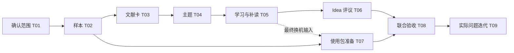

# 里程碑与任务计划

2026-09-03｜本次已经授权建立文档、里程碑与任务；科研处理范围、实际分工和日历排期由 T01 确认。

Project 是团队工作看板；Milestone 以阶段结果聚合仓库内的 Issues；Issue 是可认领和验收的交付；PR 是交付变更的审查入口。文档保存需求基线，GitHub 记录认领、进展和验收。

## 阶段结果

| 阶段 | 要交出的结果 | 任务 | 结束条件 | 相对时间 |
| --- | --- | --- | --- | --- |
| M0 范围与样本 | 启动记录、保存位置、角色及可访问样本 | T01、T02 | 范围获确认；材料有身份与实际访问状态 | D1 |
| M1 可用雏形 | 文献卡、主题页、学习与补读、Idea 评议、换机记录 | T03—T08 | 联合验收有证据，无未解决的关键阻断 | D2—D7 |
| M2 真实问题迭代 | 修复前后对照和第二轮判断 | T09，必要时再拆子任务 | 优先问题复验通过；余留问题明示 | D8—D14 |

D1 是 T01 确认的实际启动日。日期尚未确认，不填虚构的截止日期。每个任务中的工时是估算，认领者应据材料情况修订。

## 依赖关系

T02 可提前只读盘点，最终样本须按 T01 确认；T07 可与 T03—T06 并行准备文档，但关闭前必须使用 T04、T05 的实际产物换机复验。真实内容依赖不能为了并行而省略。

## 日常推进

1. 先读 Issue 的输入、交付物和完成标准，再认领；一个任务由一位同学集中整理，另一个人检查。
2. 依赖未满足时保持待做，在 Issue 中写明阻断任务与所缺材料。开始工作后将 Project 状态改为进行中。
3. 提交候选变更或 PR，列出逐项验收证据。需要评议时写明请求谁判断什么。
4. 检查者根据交付验收；有科研判断的部分由导师确认。满足全部标准再关闭 Issue 并更新为完成。
5. 阶段结束评议产品是否有用。关闭全部 Issue 是进度指标；科研理解和 Idea 价值仍看验收记录。

旧需求 #6、#7、#8、#9 等继续保留。本次任务通过链接引用其中的能力方向，范围收敛到已批准小样本；不自动关闭或重写旧需求。第二周问题没有出现前，不先造一批假设性功能单。

## 外部实践与本次选择

[GitHub Milestones 说明](https://docs.github.com/en/issues/using-labels-and-milestones-to-track-work/about-milestones)说明里程碑聚合一个仓库中的 Issues/PR；[Projects 实践](https://docs.github.com/en/issues/planning-and-tracking-with-projects/learning-about-projects/best-practices-for-projects)说明看板可显示 Issue 的负责人、里程碑等信息；[Issue 说明](https://docs.github.com/en/issues/tracking-your-work-with-issues/learning-about-issues/about-issues)说明用 Issue 跟踪工作及讨论。

可借鉴原则是让阶段结果、具体工作和交付审查相互关联。本次选择 3 个阶段、9 个任务，是基于会议“一周雏形、一周迭代”的拆分建议，并非 GitHub 的强制流程或已经验证的排期。
