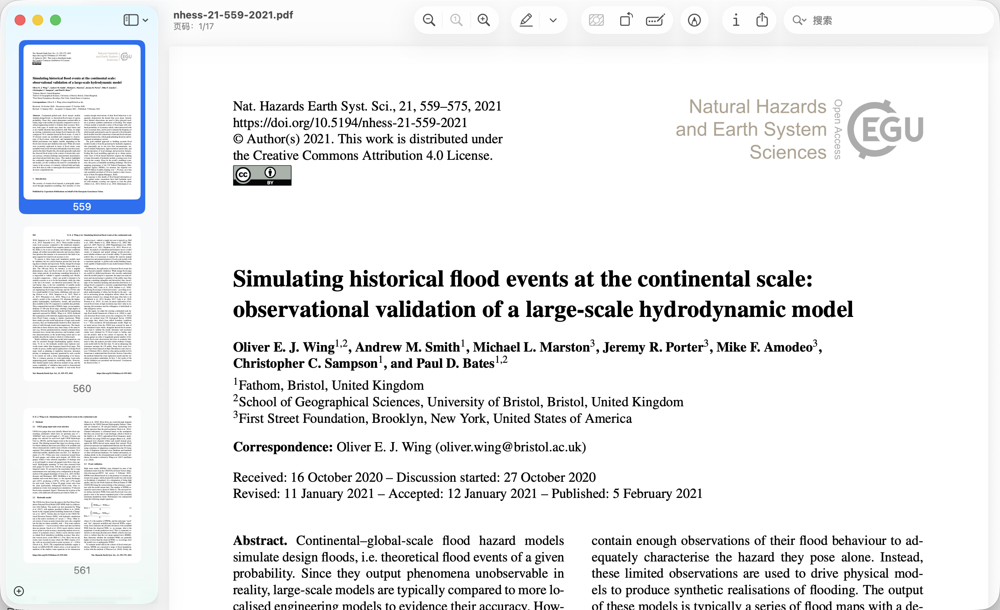
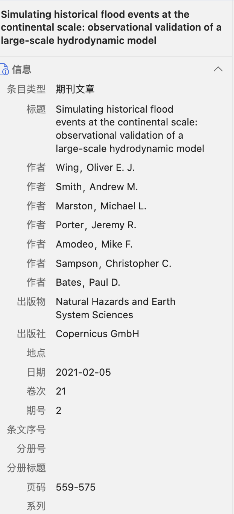

# 论文 PDF 下载（机构访问）

通过机构访问（任何有订阅的机构 SSO）自动下载学术论文。

> **依赖**：`scripts/download_paper.py` 是**独立 CLI**，直接用 Playwright 驱动本机 Chrome，
> 不依赖 Claude Code。只有"方式二（agent + MCP 浏览器）"才需要 Claude Code 的 Playwright 插件。

## 流程概览

```text
uv run python scripts/download_paper.py --doi <DOI> [--sync]
  → 脚本用 Playwright 启动本机 Chrome（无头优先）
  → 解析 DOI → 按出版商路由
  → 处理验证/机构登录(需要时由人点一次)
  → 触发 PDF 下载
  → 校验 PDF 大小与头部
  → [--sync] 拷贝到 GDrive 并写入 Zotero
```

（方式二由 Claude Code 打开 Chromium 手动操作，见下文。）

## 先搞清楚这条命令在做什么

一句话：**给它一篇论文的编号，它把 PDF 下载下来；加 `--sync` 还会顺手写进你的 Zotero。**

具体点说：

- **大多数时候不会弹浏览器。** 开放获取的论文直接用 `curl` 拉，一秒内结束。
- **只有付费墙的论文**才需要启动 Chrome，让你点一次人机验证、或登录学校的统一身份认证。
- **下载完会校验**：文件大小对不对、开头是不是 `%PDF-`。所以不会出现“以为下成功了，
  打开其实是一个报错网页”的情况。
- **加 `--sync` 会多做两件事**：把 PDF 拷进你的 Google Drive 论文目录；在 Zotero 里
  建一条记录，指向那个文件。

### 需要准备什么

| 东西 | 干什么用 | 没有会怎样 |
|---|---|---|
| 一个 DOI | 论文编号，形如 `10.5194/nhess-21-559-2021` | 也可以改用 `--arxiv <id>` 或 `--title "<标题>"` |
| Zotero 密钥 + 用户 ID | 写进 Zotero 用 | 不加 `--sync` 就不需要 |
| GDrive 论文目录路径 | PDF 存哪儿 | 同上，不加 `--sync` 不需要 |
| Playwright Chromium | 只有付费墙论文才用 | 只下开放获取论文的话，可以先跳过 |

不确定缺什么，先跑一次自检（它只检查，不下载任何东西）：

```bash
uv run python scripts/download_paper.py --setup-check
```

输出长这样，三行 `[ok]` 就说明齐了：

```text
── Zotero/GDrive setup check ──
  [ok]   env keys present
  [ok]   GDrive papers dir writable: /Users/<you>/phd/papers
  [ok]   Zotero Web API credentials valid
```

### 一次大概要多久

| 情况 | 耗时 |
|---|---|
| 开放获取（arXiv、Copernicus 等） | 1–3 秒 |
| 付费墙，不需要人操作 | 10–20 秒 |
| 付费墙，要你点验证或登录 | 30–60 秒，取决于你点多快 |
| 再加 `--sync` | 多 3–10 秒（PDF 要拷进 Google Drive） |

### 文件最后在哪

| 位置 | 什么时候有 |
|---|---|
| `<仓库>/.playwright-mcp/<doi>.pdf` | 每次下载都有 |
| `GDRIVE_PAPERS_PATH` 指向的目录 | 加了 `--sync` 才有，Zotero 记录指向的是这一份 |

## 一次性设置

> 下面四步不是每一步都要做。**只走方式一（自主脚本）**的话，跳过第 1 步——那是给方式二
> （让 agent 开浏览器）用的插件配置。第 2、3、4 步才是所有人都要做的。

### 1. 启用 Playwright 插件

在 `~/.claude/settings.json`:

```json
"enabledPlugins": {
  "playwright@claude-plugins-official": true
}
```

提供 `mcp__plugin_playwright_playwright__*` MCP 工具（独立 Chromium）。

### 2. 安装 Chromium

```bash
uv run playwright install chromium
```

### 3. 安装项目依赖

通用安装见[前提与配置](../getting-started/installation.md)。`pyzotero` 与 `playwright`
都已是核心依赖，**无需额外安装**；但浏览器二进制不在 uv 管理范围内，仍需上面的
`uv run playwright install chromium`（每台机器一次）。

### 4. 配置环境

在 `.env`:

```env
# Zotero 同步必需
ZOTERO_API_KEY=<key>          # https://www.zotero.org/settings/keys
ZOTERO_LIBRARY_ID=<id>        # 数字型用户 ID
GDRIVE_PAPERS_PATH=<path>     # 本地 GDrive 路径(ZotMoov 目标)
```

## 用法

**方式一：自主脚本模式（首选，无需交互）**

```bash
uv run python scripts/download_paper.py --setup-check          # 新机器自检一次
uv run python scripts/download_paper.py --doi 10.1029/2026GL125188 --sync
uv run python scripts/download_paper.py --arxiv 2608.18495 --sync
uv run python scripts/download_paper.py --doi <doi> --resolve-only   # 仅查元数据
```

只有标题时用 `--title`：Crossref 检索后解析成 DOI。

- 完全同名（忽略大小写与标点）→ 直接采用；同名同时存在预印本与正刊时**取正刊**；
- 否则按"你给的词被覆盖多少"打分，唯一明显胜出才采用；分数并列时优先唯一的期刊论文；
- 仍无法唯一确定 → **列出候选并返回退出码 2**，用 `--doi` 指定。绝不猜。

`--sync` 走 `zotero_sync` → `paper_to_zotero.build_item()`：arXiv 记录为 `preprint`（摘要/日期/`archiveID`）。
同 DOI 重跑会**补挂**到既有条目（不再只是跳过）；已挂同内容则幂等跳过。

脚本按 DOI 前缀自动路由到对应出版商流程，内置 **stealth Chrome 启动器**
（真实 Chrome 内核 + 剥离自动化标记）。首次使用需 `uv run playwright install chromium`。

**无头优先**：第一次尝试不弹窗，脚本以 headless 模式静默运行。
**无头只要失败，就会用可见窗口重试一次**——不要求先看到验证（ScienceDirect 在无头下会直接
`ERR_ABORTED`，却根本不弹验证）。

对于**没有专用 flow** 的前缀，进入通用流程前还有一次验证检查：15 秒内
（`HEADLESS_CHALLENGE_GRACE_S`）没能通过就提前升级。有专用 flow 的前缀
（`10.1016`/`10.1029`/`10.1002`/`10.1175`/`10.1038`/`10.2139`）不做入口预导航——
第二次 `goto` 会打断它们的重定向链（ScienceDirect 会报 `ERR_ABORTED`），改由各流程自己处理验证。
已解析出刊社落点的中文期刊 DOI 同样跳过入口预导航：`doi.org` 对它们不可用，落点由通用 flow
直接打开（见下文「中文期刊（CNKI DOI）」）。

流程中途若再次弹出验证，会继续等你通过，不会直接判定失败：

```
⚠ 请在浏览器中完成人机验证（点几次都行）。完成后无需回到终端，程序会自动继续。
```

你**只需点验证**：出现几次就点几次，点完不用回终端，脚本会自动续上下载。

**直接有头的两家**：`10.1016`（ScienceDirect，无头必 `ERR_ABORTED`，且必须人点验证）
和 `10.3724`（sciengine，无头直接 403）不做无头尝试，一上来就开可见窗口。

其他出版社如果无头失败（但没有弹出验证），脚本同样会用可见窗口重试一次，只是不会要求你点验证。

**方式二：agent + Playwright MCP 浏览器**（脚本无法覆盖的出版商或需人工登录时）

```
/download-pdf 10.1038/s41586-026-10704-3
```

agent 打开 Chromium 窗口。你只需在以下情况交互：
- **Cloudflare 挑战**出现（Wiley/AGU）——在浏览器里点击复选框
- **机构登录**需要——在浏览器里完成机构 SSO 登录

## 实际运行效果

下面是真实终端输出，不是示意。

**开放获取（Copernicus），带 `--sync` 入库**

```text
$ uv run python scripts/download_paper.py --doi 10.5194/nhess-21-559-2021 --sync
Simulating historical flood events at the continental scale: observational valid
  Natural Hazards and Earth System Sciences | 10.5194
  Copernicus curl: https://nhess.copernicus.org/articles/21/559/2021/nhess-21-559-2021.pdf
SAVED: .playwright-mcp/10.5194.nhess-21-559-2021.pdf (16155441 bytes)
   DOI index: 1 changed, 0 deleted
OK — Zotero item created
  Key:        SH6PVR6X
  Title:      Simulating historical flood events at the continental scale: observational
              validation of a large-scale hydrodynamic model
  DOI:        10.5194/nhess-21-559-2021
  Attachment: linked_file → attachments:nhess-21-559-2021.pdf
  PDF copied: /Users/<you>/phd/papers/nhess-21-559-2021.pdf
```

**arXiv 预印本，只下载不入库**

```text
$ uv run python scripts/download_paper.py --arxiv 2110.10833
arXiv curl: https://arxiv.org/pdf/2110.10833
SAVED: .playwright-mcp/arXiv.2110.10833.pdf (532233 bytes)
```

这两条都**没有打开浏览器窗口**：开放获取走 `curl`，只有付费墙才拉起 Playwright。
`SAVED` 后面的字节数是校验过 PDF 头部之后的结果，不是 HTTP 响应的 Content-Length。

下载完直接打开，就是正常的论文正文（17 页），不是“下到一半的报错页”：

{width=720}

加了 `--sync` 之后，这篇论文在 Zotero 里长这样——标题、七位作者、期刊、卷期页码都是自动
从 Crossref 取的，PDF 挂成链接附件：

{width=360}

### `--sync` 之后还要等 Desktop 同步

`--sync` 通过 **Zotero Web API** 建条目，而 `hydrolitagent cards paper-input` 读的是
**Zotero Desktop 的 Local API**。Desktop 没同步完，卡片流程就看不到这篇：

```text
$ curl -s http://127.0.0.1:23119/api/users/0/items/SH6PVR6X
HTTP 404                              ← Desktop 还没同步
```

在 Zotero 里点一次同步（或等它自己同步），同一个 key 就变成 200：

```text
HTTP 200
标题: Simulating historical flood events at the continental scale: observati…
```

之后 `paper-input` 才会返回 `READY / PDF_READY`。这不是 bug，但不知道就会以为入库失败了。

## 支持的出版商

| 出版商 | 访问方式 | 下载模式 |
|--------|---------|---------|
| **Nature** | OA：直接 | 点击 "Download PDF" → Chrome 原生下载 |
| **Nature** | 机构 | WAYF → 机构 SSO → 点击 "Download PDF" |
| **Wiley** | 任意 | `pdfdirect?download=true` URL 触发原生下载 |
| **AGU** | 任意 | 同 Wiley（`agupubs.onlinelibrary.wiley.com`） |
| **AMS** | 机构/IP | aop→published redirect → `context.request` 取 PDF 字节 |
| **Elsevier (ScienceDirect)** | SSO 自动识别 | 导航 → "View PDF" → 新标签页(可能经安全校验)→ 同源 `<a download>` 锚点 → 原生下载 |
| **Copernicus (ESSD 等)** | 开放获取 | 直链 `curl -L` 下载(静态 PDF 锚点无效) |
| **science.org** | 开放获取 | curl 两步法优先；被 Cloudflare 拦截时回退浏览器（无头优先） |
| **SSRN** | 免费下载 | 浏览器访问摘要页 → 无头优先，必要时弹窗过一次验证 → 点击下载 |
| **其他（未列出的前缀）** | 视出版社 | 通用 flow：读 `citation_pdf_url` / PDF 锚点 → 导航触发下载 |
| **中文期刊（CNKI DOI）** | 站点公开 PDF | Crossref 无记录 → `chndoi.org` 解析页 + 刊社 `citation_*` → 打开刊社文章页取 PDF；定位不到时用 `--landing-url` / `--pdf-url` |

## 工作原理

### Nature / Springer

Nature 文章用简单模式：

```
Article: https://www.nature.com/articles/s41586-026-10704-3
PDF:     https://www.nature.com/articles/s41586-026-10704-3.pdf
```

- **OA 论文**：文章页上的 "Download PDF" 链接触发 Chrome 原生下载
- **机构论文**：浏览器重定向到 `wayf.springernature.com`（WAYF）。agent 在 WAYF 里选择你所属的机构，用户完成该机构的 SSO 登录。WAYF/SSO cookie 在浏览器配置中跨 Claude Code 重启持久化

### Wiley / AGU

Wiley 使用 Cloudflare Turnstile 反爬保护。用户手动通过挑战后，agent 使用 `pdfdirect` 端点：

```
https://onlinelibrary.wiley.com/doi/pdfdirect/<DOI>?download=true
https://agupubs.onlinelibrary.wiley.com/doi/pdfdirect/<DOI>?download=true
```

这直接触发 Chrome 原生下载——无 PDF 查看器、无 base64 编码。Cloudflare cookie 在会话内持久化，后续 Wiley/AGU 论文跳过挑战。

### ScienceDirect

点 "View PDF" 后新标签页**可能**先到 security-verification 页（`pdf.sciencedirectassets.com/craft/capi/cfts/init?...`，几秒自动跳转），也可能直跳签名 `main.pdf` URL。签名 URL 是**一次性**的（`X-Amz-Expires=300`，约 5 分钟过期）——**不要对其重新 `page.goto`**（会消耗并跳回文章页）。在该 PDF 标签页用同源 `<a download>` 锚点触发 Chrome 原生下载。首次访问文章页可能遇 "Are you a robot?" captcha——暂停让用户手动完成。

### Copernicus / 开放获取直链 PDF

预印本/文章页暴露纯 `.pdf` 直链（无 `pdfft`/`pdfdirect`）。这类**静态 PDF 按 inline 提供，锚点下载不触发**（无 "Downloading..." 事件）。直接用 `curl -L` 拉取：

```bash
curl -sL -A "Mozilla/5.0" -o paper.pdf "https://essd.copernicus.org/preprints/<msid>/<msid>.pdf"
```

Copernicus 偶有慢速/超时——curl 中断用 `wget -c` 续传，或 Python urllib 配 120s 超时。

### Stealth Chrome 脚本模式（scripts/download_paper.py）

裸 Playwright Chromium 带 `navigator.webdriver=true` 和 `--enable-automation` 开关，Cloudflare 靠指纹识别后**每次导航都重新弹验证**（即使人工通过也没用——这不是 IP 封禁）。脚本模式改用：

- `channel="chrome"`（本机真实 Chrome）+ `ignore_default_args=["--enable-automation"]`
- `--disable-blink-features=AutomationControlled` + init-script 掩蔽 `webdriver`
- persistent profile（临时目录下），验证 cookie 跨次运行复用

效果：AMS "Human Verification" 多数情况下自动通过；ScienceDirect 直接有头启动，
不存在"无头→有头"的升级。

### AMS

stealth 指纹过掉验证页后，用 `page.context.request.get(downloadpdf_url)`（带文章页 Referer，cookie 自动共享）直接取 PDF 字节。**不要**用 `expect_download` + `save_as`——下载触发后页面立即关闭，save 会竞速失败（TargetClosedError）。

### science.org

开放获取，但站点现已接入 Cloudflare：curl 两步法**经常直接拿到挑战页而不是 PDF**，
此时脚本自动回退到浏览器。curl 仍是最快路径，优先保留：

```bash
# 第一步：访文章页设 cookie
curl -sL -A "Mozilla/5.0" -c cookies.txt -b cookies.txt -o /dev/null "https://www.science.org/doi/<DOI>"
# 第二步：带 cookie 拉 PDF
curl -sL -A "Mozilla/5.0" -c cookies.txt -b cookies.txt -o paper.pdf "https://www.science.org/doi/pdf/<DOI>?download=true"
rm cookies.txt
```

curl 失败后脚本走 `generic_flow`（2026-10-18 用 `10.1126/sciadv.aeb1692` 实测通过）：

1. 真实 Chrome 打开文章页，Cloudflare 约 2 秒自动放行；
2. **页内 `fetch()` / `context.request` 取不到字节**（仍 403），不要走这条路；
3. 让**页面导航**到 `/doi/pdf/<DOI>?download=true`，Playwright 会以
   `Error: Download is starting` 的形式报告下载开始，用 `expect_download()` 包住即可保存。

### 点按钮才出 PDF 的站点（sciengine / 10.3724）

水利学报等中文期刊落在 **sciengine.com**，和国外出版社机制不同：

- 它是单页应用，纯 HTTP 请求任何路径都只返回一份 3 KB 空壳；
- 无头浏览器直接 403，所以 `10.3724` 归入**有头专属**；
- PDF 由页面上的「预览PDF」触发，经两级 302 跳转后由浏览器在新标签页加载一次
  `application/pdf`，实测约 30 秒才出现。

因此对这类站点**不去猜 URL**，而是：等页面渲染出 PDF 控件 → 点击 → 在浏览器上下文层面
监听 `application/pdf` 响应。**注意不能直接读响应体**——浏览器内联预览 PDF 时，
Playwright 取不到该响应的 body（异常还被静默吞掉，会表现成"一直没响应"）。所以流程是：
先记录响应 URL（如 `files.sciengine.com/pdfs/...`），再用带 cookie 的浏览器上下文回取，
回取时限 3 分钟。SPA 站点等响应的宽限是 **5 分钟**（其他站点 120 秒），一出现就立即处理；
45 秒没反应会再点一次；等待期间每 15 秒打印一行进度。

### 未写专用 flow 的出版社

以前遇到未知 DOI 前缀会直接 `SystemExit("no scripted flow yet")`，现在改走通用 flow，
按顺序尝试三步：

1. **响应捕获**：找页面上自带的 PDF 控件并点击，监听 `application/pdf` 响应
   （页面没有这类控件时立即跳过，零成本）；
2. **候选 URL**：`citation_pdf_url` / PDF 锚点 / DOI 布局，先试直接取字节，再试「导航即下载」；
3. **锚点兜底**：注入同源 `<a download>`。

遇到验证同样是无头优先、失败弹窗、点完自动继续。

### 中文期刊（CNKI DOI）

CNKI 系中文期刊的 DOI（如 `10.14042`；这类前缀有几十个，不按前缀硬编码）**不在 Crossref /
DataCite 注册**，`https://doi.org/<doi>` 会落到证书域名不匹配的 `link.cnki.net`，浏览器直接拒绝加载。
脚本因此按「解析页 → 刊社文章页」的路径走：

1. `crossref_meta` 404 → `hydrolitagent/literature/chinese_doi.py` 请求
   `https://www.chndoi.org/Resolution/Handler?doi=<urlencoded>`，取题名、作者、出版机构、注册时间
   （**只**用题名/作者入库：出版机构是 CNKI 注册方、注册时间是登记日期，二者都不写入 Zotero）；
2. 依次打开解析页给出的境内/境外链接，读刊社页面的 `citation_*` meta
   （刊名、ISSN、卷期页、`citation_pdf_url`、摘要）；
3. `generic_flow` 的落点改为**刊社文章页**（不是 `doi.org`）；`citation_pdf_url` 作为第一个候选，
   先走共享 cookie 的 `context.request` 取字节，再用页面导航/锚点兜底。

`--resolve-only` 会打印解析结果，中文路径多一个 `"source": "chndoi"`：

```bash
uv run python scripts/download_paper.py --doi 10.14042/j.cnki.32.1309.2026.06.001 --resolve-only
```

解析页若只给出 CNKI 链接（CNKI 系 DOI 的常见情况），`--resolve-only` 仍能打印题名/作者，
但**下载会秒级失败并给出提示**，不会对着不可达的 CNKI 主机空跑两轮浏览器：

```text
FAILED: this DOI only resolves to CNKI, which serves a mismatched TLS certificate
        and rejects scripted access.
  Pass the journal's own article page instead: --landing-url / --pdf-url
```

这时补上刊社文章页即可（页面上的 `citation_pdf_url` 会被自动选用）：

```bash
uv run python scripts/download_paper.py --doi 10.14042/j.cnki.32.1309.2026.06.001 \
    --landing-url http://skxjz.nhri.cn/cn/article/doi/10.14042/j.cnki.32.1309.2026.06.001 --sync
```

同一条命令重跑是幂等的：PDF 已挂且内容一致时 `zotero_sync` 报
`already attached (identical content)`，不会新建重复条目。

当解析结果里**没有任何可打开的页面**（未注册 DOI、解析页不可达、站点改版导致链接丢失），
同样**不会退化成乱猜**：脚本报错并提示手工指定。

```bash
uv run python scripts/download_paper.py --doi <中文DOI> \
    --landing-url https://<刊社文章页> --sync
# 只有 PDF 直链时：
uv run python scripts/download_paper.py --doi <中文DOI> --pdf-url https://<xxx.pdf> --sync
```

- 页面编码依次回退：`Content-Type` → `<meta charset>` → UTF-8 → `gb18030`，老刊的 GBK 页可读；
- 滑块/验证页（标题含 `安全验证`、`拖动滑块`）按挑战页处理，沿用无头→有头的升级逻辑；
- 自动路径下 Zotero 条目为 `journalArticle`、`language=zh`，中文作者写成 `family=全名, given=""`，
  卷期页与中文刊名取自刊社页面。
- **手工兜底同样带着元数据入库**：`download_paper` 把已解析的记录经环境变量
  `MYLIBRARY_SOURCE_META` 交给 `zotero_sync` 子进程，所以 `--landing-url` 解析出的
  刊名/卷/期/页不会丢。早期版本会重解析一次，导致这条路径只挂上 PDF、卷期页缺失，已修。

`--sync` 的两个条目冲突开关也可直接透传（此前只能手工跑 `zotero_sync`）：
`--replace`（同名附件内容不同时覆盖）与 `--skip-existing`（DOI 已存在则整篇跳过）。

### SSRN

SSRN 预印本免费下载。Cloudflare 挑战在 MCP 浏览器 profile 下自动通过。访问摘要页
`https://papers.ssrn.com/sol3/papers.cfm?abstract_id=<id>`，等待验证通过后点击
下载按钮即可。

### 反模式（DO NOT USE）

| 模式 | 为什么坏 |
|------|---------|
| `browser_evaluate` + `fetch()` + `readAsDataURL()` | Base64 超 MCP 传输限制 → 崩溃 |
| `browser_run_code` + `require('fs')` | MCP 运行时未定义 `require` |
| `mcp__plugin_ecc_playwright__*` | 需要 Chrome 扩展桥，非独立 |
| `python -m hydrolitagent.literature.zotero_sync` | 用 `uv run python`——conda Python 缺依赖 |
| 裸 Playwright Chromium 反复被 Cloudflare 拦 | `navigator.webdriver` 指纹暴露；用 stealth 启动器（`channel="chrome"` + 去 automation 标记） |
| `context.request` 拉 ScienceDirect 签名 PDF | assets CDN 对非浏览器 TLS 指纹返回 403（AMS 可用，SD 不可用） |
| main.pdf URL 一出现就注入锚点 | 二次重定向会摧毁执行上下文——先等 URL 稳定 |
| 浏览器上下文长时间运行后崩溃 | 约 8 次导航后 stealth temp profile 不稳定；用 MCP profile（脚本已自动优先） |
| science.org 浏览器报 `ERR_TOO_MANY_REDIRECTS` | 旧版无头浏览器被 bot 检测拦下；curl 两步法优先，失败时脚本回退到**真实 Chrome**（导航到 `/doi/pdf/` 触发下载），已实测可用 |

## 命令参考

```bash
# 一条命令：解析 → 按出版商路由 → 下载 → 验证（--sync 加入库）
uv run python scripts/download_paper.py --doi <doi> [--sync] [--out DIR]
uv run python scripts/download_paper.py --arxiv <id> [--sync]
uv run python scripts/download_paper.py --doi <doi> --resolve-only   # 仅查元数据

# 中文期刊（CNKI DOI）解析不到刊社站点时手工指定
uv run python scripts/download_paper.py --doi <doi> --landing-url <文章页> [--sync]
uv run python scripts/download_paper.py --doi <doi> --pdf-url <PDF 直链> [--sync]

# --sync 的条目冲突开关（透传给 zotero_sync）
uv run python scripts/download_paper.py --doi <doi> --sync --replace         # 覆盖同名但内容不同的附件
uv run python scripts/download_paper.py --doi <doi> --sync --skip-existing   # DOI 已存在则整篇跳过

# 只有标题、没有 DOI 时：Crossref 检索后解析成 DOI
uv run python scripts/download_paper.py --title "<标题>" [--sync]

# 解析和分类输入
uv run python -m hydrolitagent.literature.download_pdf doi <doi>
uv run python -m hydrolitagent.literature.download_pdf classify <input>
uv run python -m hydrolitagent.literature.download_pdf detect <url>

# 计算输出路径
uv run python -m hydrolitagent.literature.download_pdf output-path <doi>

# 解码 base64（遗留，仅小 PDF）
uv run python -m hydrolitagent.literature.download_pdf decode <input> <output>

# 验证 PDF
uv run python -m hydrolitagent.literature.download_pdf verify <pdf>
```

## 失败模式

| 症状 | 原因 | 修复 |
|------|------|------|
| 页面标题 "请稍候…" / 403 | Cloudflare Turnstile 拦截 | 无头阶段 15 秒内过不去会自动弹窗；在弹出的窗口里点一次验证即可，程序会自行续跑 |
| "Access through your institution" | 未登录 / 会话过期 | 走 WAYF → 机构 SSO 流程 |
| "Buy or subscribe" / 无 PDF 链接 | 期刊不在 DUT 订阅中 | 跳过——从其他来源下载 |
| 大 PDF 时 MCP 崩溃 | base64 编码溢出 | 用 Chrome 原生下载，不用 evaluate |
| `ModuleNotFoundError: pyzotero` | 用错 Python（`python` vs `uv run python`） | 始终用 `uv run python` |
| Copernicus 锚点下载无文件 | 静态 PDF inline 提供，锚点不触发下载 | `curl -L` 直连 |
| Zotero 同步超过 900 秒 | 大文件 + GDrive 拷贝慢 | 脚本打印 FAILED，**PDF 已保存**；单独重跑 `python -m hydrolitagent.literature.zotero_sync <pdf> <doi>` |
| 浏览器流程崩溃 | 流程内部异常 | 退出码 1，只打印一行 `FAILED: browser flow crashed (...)`，不再吐 traceback |
| ScienceDirect 签名 URL 重导航后跳回文章页 | 签名 URL 一次性 | 回文章页重点 "View PDF" 获取新 URL |
| `拒绝不安全地址：拒绝非公网地址：<域名> -> 198.18.0.x` | 本机代理开了 fake-IP 模式，所有域名都被解析到基准测试网段（RFC 2544 / RFC 5180） | 升级到识别 `198.18.0.0/15` 与 `2001:2::/48` 的版本——全部解析结果都落在该网段时放行，混入真实私网地址仍然拒绝；或临时关掉 fake-IP |
| `ITEM_NOT_FOUND`（条目刚建好） | `--sync` 写的是 Web API，Desktop 尚未同步 | 在 Zotero 里点一次同步，见上文「`--sync` 之后还要等 Desktop 同步」 |

## 常见问题

**我只知道标题，没有 DOI 怎么办？**

用 `--title "<完整标题>"`，它会去 Crossref 查。查不到唯一结果时**不会乱猜**，而是列出
候选并返回退出码 2，你挑一个用 `--doi` 指定就行。

**下完了，但 Zotero 里搜不到？**

两种可能，按顺序排查：

1. 加 `--sync` 之后，Zotero **还在同步**。等几十秒到几分钟。`--sync` 的输出里有一行
   `Key: XXXX`，拿它在 Zotero 搜索框里搜，能搜到就是同步好了。
2. Zotero 根本没在跑，或者 `ZOTERO_LIBRARY_ID` 指向的不是你以为的那个库。

**同一个 DOI 跑第二次会不会搞出重复条目？**

不会。默认行为是“补挂”：条目已存在就往上面补附件；内容完全一样就跳过。要强制替换用
`--replace`，要整篇跳过用 `--skip-existing`。

**我只想下载，不想碰 Zotero。**

去掉 `--sync`。不加就不写任何 Zotero 数据。

**它会偷偷改我的 Zotero 吗？**

不会。不加 `--sync` 全程只读；加了 `--sync` 只会做两件事之一：新建一条记录，或者给已有
记录挂一个附件。

**下载失败，日志里有“拒绝不安全地址”？**

见上面失败模式表里 fake-IP 那一行——是本机代理的 DNS 把域名解析到了保留网段，
不是论文地址真的有问题。

## 相关

- [Zotero 入库（linked_file）](zotero-sync.md)
- [论文入库流水线](paper-pipeline.md)
- [ADR-0001：linked_file 设计](../adr/0001-zotero-linked-file-sync.md)
- [配置参考](config.md)
