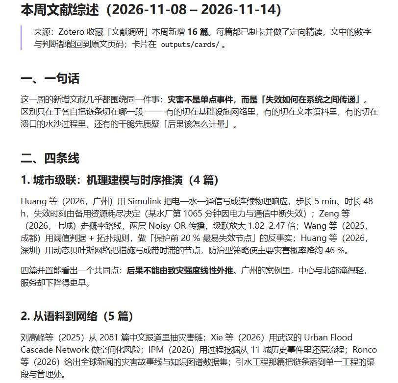
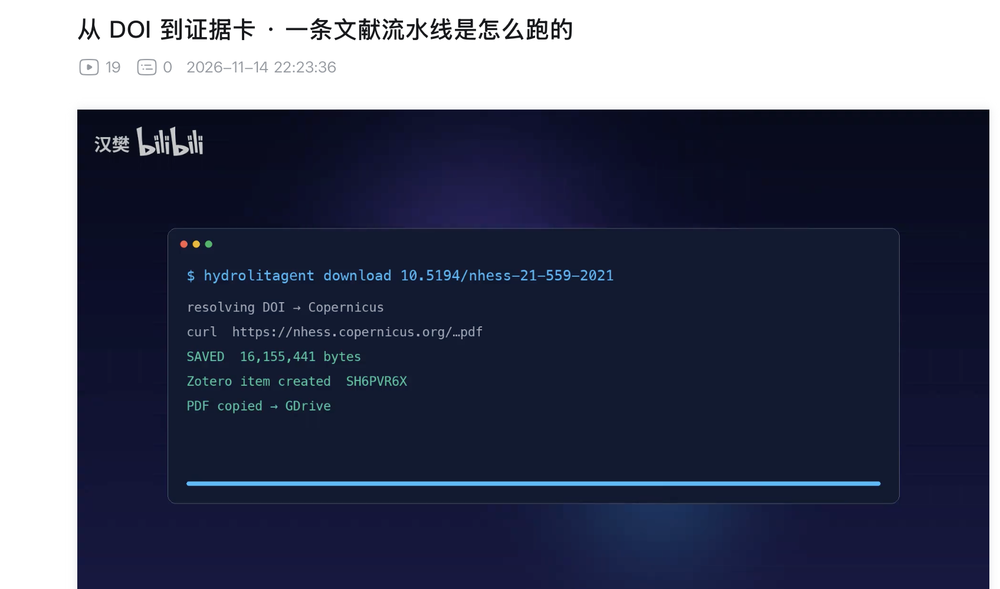

# 文献深度处理（Literature CLI）

从 dailyinfo 迁入的文献处理能力：**精读、主题、公众号、B 站发布**。
它与「文献卡与主题卡」是两条不同的路子 —— 这边产出**当期内容**（文章、分析卡），
那边把文献沉淀成**长期可追溯**的资产。

每周综述的产物长这样（`$OUT/weekly-review/<date>/`）—— 一批新增文献按几条主线归组，每条判断都能回到卡片与原文页码：

{width=720}

## 先搞清楚这个页面在讲什么

这一页挂着六七条命令，一次全看会晕。其实它们服务的是几条互不相干的产线：

| 你想干的事 | 用哪条命令 | 最后得到什么 | 要不要联网账号 |
|---|---|---|---|
| 把一篇论文弄进自己的文献库 | `scripts/download_paper.py` | Zotero 里多一条记录 + 一个能打开的 PDF | 要（Zotero 密钥） |
| 把一段录音发到 B 站 | `bilibili_upload` | 一条公开视频，带自动生成的封面 | 要（B 站登录） |
| 把文章传进公众号草稿箱 | `wechat.push` | 公众号后台的草稿，**还没群发** | 要（公众号 AppID/Secret） |
| 让周报文章读起来更顺 | `wechat.polish` | 改写后的 Markdown（**只适合周报**） | 要（DeepSeek 密钥） |
| 给文章配图或封面 | `wechat.figure` | 插进文章的图片 | 要（智谱密钥） |

**第一次用，按这个顺序走**（每一步都能单独验证，出问题不用重来）：

1. 跑 `uv run python scripts/download_paper.py --setup-check`。它只检查配置，不下载任何东西
2. 找一篇**开放获取**的论文试下载，比如
   `--doi 10.5194/nhess-21-559-2021`。这类不需要学校账号，最快能看到结果
3. 上面通了，再加 `--sync`，让它真正写进 Zotero
4. B 站、公众号是另外两条独立的线，等你要发东西的时候再配，不用一开始全配齐

### 几个会反复出现的词

| 词 | 大白话 |
|---|---|
| **DOI** | 论文的“身份证号”，形如 `10.5194/nhess-21-559-2021`。有它就一定能定位到那篇文章 |
| **Zotero** | 管文献的软件。“入库”= 让这篇论文出现在你 Zotero 的列表里 |
| **开放获取（OA）** | 出版社免费公开的论文，不需要学校账号就能下 |
| **付费墙** | 要有学校订阅才能下。只有这类才需要弹浏览器、人工点一次验证 |
| **linked_file** | Zotero 里只存一个“文件在哪”的指针，PDF 本体留在你的 Google Drive 目录里 |
| **`--sync`** | “顺便写进 Zotero”。不加就只是把 PDF 下到本地 |
| **`--dry-run`** | “只做前面几步，别真的发出去”。第一次跑一定要加 |
| **TTY** | 真正的终端窗口。有些命令（比如登录 B 站）必须在终端里跑，重定向或后台运行会直接报错 |

## CLI 用法（统一用 `uv run python -m`）

```bash
# 论文 PDF 下载（独立 CLI，无需 MCP 插件）
uv run python scripts/download_paper.py --doi <doi> [--sync]

# PDF 辅助命令(detect/verify，无需浏览器)
uv run python -m hydrolitagent.literature.download_pdf verify <pdf>
uv run python -m hydrolitagent.literature.download_pdf detect <url>

# Zotero 入库(linked_file)
uv run python -m hydrolitagent.literature.zotero_sync <pdf> <doi> --json

# B 站上传(封面自动生成)
uv run python -m hydrolitagent.literature.bilibili_upload <audio.mp3> \
  --title "标题" --tags "AI,水文,科研" [--dry-run]

# 公众号发布
uv run python -m hydrolitagent.literature.wechat.push <polished.md> [--thumb <media_id>]

# 公众号润色
uv run python -m hydrolitagent.literature.wechat.polish <draft.md>

# 配图/封面(需 ZHIPUAI_API_KEY)
uv run python -m hydrolitagent.literature.wechat.figure <article.md>
```

## B 站投稿：从音频到稿件

`bilibili_upload` 把一段音频变成一条视频稿件：自动生成封面 → `ffmpeg` 合成 1080p MP4 →
`biliup` 上传。封面长这样（1920×1080，标题和日期自动填）：

{width=720}

**为什么中间要转一次视频？** B 站只收视频文件，不收纯音频。所以流程是
“一张静态封面 + 一段音频 → 合成一个 MP4”，其中：

- `ffmpeg` 负责“合”这一步（拼图 + 音轨）；
- `biliup` 负责“传”这一步（登录 B 站、断点续传、选线路）。

两个都不是 Python 包，得单独装，装好放在 `PATH` 里就行。

### 前置：两个外部程序 + 一次登录

Python 侧不需要额外依赖，但要两个系统程序：

| 程序 | 用途 | Windows | macOS | Linux |
|------|------|---------|-------|-------|
| `ffmpeg` | 音频 + 封面 → MP4 | `winget install ffmpeg` | `brew install ffmpeg`，或取静态二进制放到 `~/.local/bin` | `apt install ffmpeg` |
| `biliup` | 上传（含登录态管理） | `winget install --id=ForgQi.biliup-rs -e` | 从 [biliup-rs releases](https://github.com/biliup/biliup-rs/releases) 取 `biliupR-*-aarch64-macos.tar.xz`，解压后放到 `~/.local/bin` | 同 macOS，取对应架构包 |

两个都要在 `PATH` 上——脚本用 `shutil.which` 找 `biliup`，`ffmpeg` 直接按名字调用。

登录一次即可（B 站登录态有效期约两年）：

```bash
biliup -u ~/.bilibili/cookies.json login
```

它会先给一个菜单（账号密码 / 短信 / 扫码 / 浏览器），选「扫码登录」用手机 App 扫，或选
「浏览器登录」拿一条 `passport.bilibili.com/...` 链接在浏览器里登录。凭证写到
`~/.bilibili/cookies.json`，之后所有投稿都复用它。

> **必须在真实终端里跑**：`biliup login` 需要 TTY，重定向或后台运行会报
> `Error: IO error: not a terminal`。

### 实际运行效果

先干跑一次，确认封面和视频都对（不上传）。下面把音频名统一写成 `podcast.mp3`，
其余行是真实输出：

```text
$ uv run python -m hydrolitagent.literature.bilibili_upload podcast.mp3 \
    --title "水文AI周报 测试" --tags "AI,水文" --dry-run
[21:46:09] === Bilibili Upload (1P) ===
[21:46:09]   generating cover for podcast → 'AI for Science · 前沿论文'
[21:46:09]   cover generated → outputs/bilibili-upload/podcast_cover.png
[21:46:09]   ffmpeg: podcast.mp3 + podcast_cover.png → podcast.mp4
[21:46:09]   video saved → outputs/bilibili-upload/podcast.mp4
[21:46:09]   artifacts saved → outputs/bilibili-upload/2026-11-14
[21:46:09]   [dry-run] skipping upload
[21:46:09] === Dry-run complete ===
```

产物核对：`ffmpeg -i` 应显示 `h264 (High) … yuv420p, 1920x1080, 25 fps` 和一条 AAC 音轨。

去掉 `--dry-run` 就是真投稿：

```text
[21:58:15]   uploading to Bilibili (1P)...
[21:58:15]   title: 水文AI文献库 · 投稿链路验证
[21:58:15]   tags:  AI,水文,科研,工具链
[21:58:15]   tid:   171
2026-11-14 21:58:15  INFO biliup::uploader::credential: 通过cookie登录
2026-11-14 21:58:15  INFO biliup::uploader: user: <你的账号>
2026-11-14 21:58:19  INFO biliup::uploader: Upload completed: podcast.mp4 => cost 0.33s, 1.29 MB/s.
2026-11-14 21:58:19  WARN biliup::uploader::bilibili: 客户端接口已失效, 将使用APP接口
2026-11-14 21:58:19  INFO biliup::uploader::bilibili: APP接口投稿成功
[21:58:19]   cleaned up auto covers
[21:58:19] === Upload complete! ===
```

过了审的稿子长这样（标题、播放量、投稿时间都在，播放器里放的就是合成出来的视频）：

{width=720}

日志里那句 `客户端接口已失效, 将使用APP接口` 是 biliup 在 B 站改接口后的自动降级，
不影响结果。但降级偶尔不发生，那时会直接报：

```text
ResponseData { code: 42002, message: "返回状态错误（非常规捕捉）" }
```

绕法是自己调 `biliup` 并显式指定 APP 接口：

```bash
biliup -u ~/.bilibili/cookies.json upload video.mp4 --submit app \
  --title "…" --tag "…" --tid 171 --cover cover.png
```

这样还能用上本模块没包的部分（比如直接投稿一个自己做好的视频，而不是从音频合成）。

新稿件要过审才可见，通常几分钟。这段时间公开接口查 `BV` 号会返回 `-404`，
创作中心里状态是 `state: -30 审核中`，都是正常的。

### 产物落点

```
outputs/bilibili-upload/
├── <名字>_cover.png          # 自动生成的封面（--keep-cover 才保留，否则投稿后清理）
├── <名字>.mp4                # 合成的视频
└── YYYY-MM-DD/               # 当次归档：mp4 + cover + description.md
```

## 公众号发布的前置条件

公众号这条链路比 B 站多两道门槛，**配置不全会直接失败**：

1. `.env` 里必须有 `WECHAT_APPID`、`WECHAT_APPSECRET`、`WECHAT_THUMB_MEDIA_ID`
   （封面图要先在公众号后台上传成永久素材，拿 `media_id`）。缺任何一个，
   取 access_token 就会报 `errcode: 41002, errmsg: appid missing`。
2. `draft/add` 接口要求**服务器 IP 在白名单里**（公众号后台 → 设置与开发 → 基本配置）。
   本机公网 IP 没加进去会报 `40164`。

`wechat.push --dry-run` 不需要凭证，只把 Markdown 转成带内联样式的 HTML，可以先看排版：

```bash
uv run python -m hydrolitagent.literature.wechat.push draft.md --dry-run
```

`wechat.push` 只写**草稿箱**，不会直接群发。

> ⚠️ `wechat.polish` 也是要凭证之外的东西：它把 `skills/weekly-report-skill/SKILL.md`
> 当作系统提示词，**专门为「每周文献综述」设计**。喂一篇不是周报格式的文章进去，
> 模型会按周报模板重写，并为填满「论文卡片」的槽位编造论文。
> 用于周报草稿；不要拿它润色其他类型的文章。

## 依赖的环境变量

| 变量 | 用途 | 去哪儿拿 |
|------|------|---------|
| `ZOTERO_API_KEY` | Zotero Web API 密钥 | [zotero.org/settings/keys](https://www.zotero.org/settings/keys) 新建一个，勾上允许写入 |
| `ZOTERO_LIBRARY_ID` | Zotero 数字型用户 ID | 同一个页面上写着 “Your userID for use in API calls” |
| `GDRIVE_PAPERS_PATH` | GDrive 论文文件夹 | Zotero → 设置 → 高级 → 文件和文件夹 → 链接附件根目录 |
| `ZHIPUAI_API_KEY` | 智谱 AI（CogView）配图/封面 | [bigmodel.cn](https://bigmodel.cn) 控制台 |
| `WECHAT_APPID` / `WECHAT_APPSECRET` | 公众号发布 | 公众号后台 → 设置与开发 → 基本配置 |
| `WECHAT_THUMB_MEDIA_ID` | 公众号封面 | 后台传一张永久封面图，取它的 `media_id` |

> ⚠️ **“键存在”不等于“配上”**。`.env` 里写了 `WECHAT_APPID=` 但等号后面是空的，
> 程序读到的是空字符串，行为跟没写完全一样——报错还不一定会指出是这一行。
> 配完用下面的命令确认每个值真的有内容（只显示长度，不打印密钥）：
>
> ```bash
> python3 -c "
> for line in open('.env', encoding='utf-8'):
>     if line.startswith(('ZOTERO_','GDRIVE_','WECHAT_','ZHIPUAI_','DEEPSEEK_')):
>         k, _, v = line.partition('=')
>         print(f'{k:24s} 长度={len(v.strip())}')
> "
> ```

> ⚠️ 凭据一律从环境变量读取,**不要把 API 密钥硬编码进源码**。`push.py` 曾硬编码微信凭据,迁移时已修复为 env 读取。

## 常见问题

**B 站提示 `Error: IO error: not a terminal`**

登录那一步必须在**真正的终端窗口**里跑。放进脚本、`| tee`、后台运行、或者某些 IDE 的
集成终端都会报这个。开一个系统自带的 Terminal 窗口重跑 `biliup login` 即可。

**装完 `biliup` 却提示命令找不到**

`~/.local/bin` 没在 `PATH` 里。验证一下：

```bash
which biliup ffmpeg        # 两个都应该打印出路径
```

没有的话，在 `~/.zshrc`（或 `~/.bashrc`）里加一行 `export PATH="$HOME/.local/bin:$PATH"`，
然后 `source ~/.zshrc` 或重开终端。

**封面上的中文变成一排方框**

系统里没找到带中文字形的字体。装在 macOS 上一般不会遇到（自带冬青黑体），
Linux 最小安装常见。装一个中文字体（如 Noto Sans CJK）即可；程序也会打一条
`WARNING: 没有找到带中文字形的字体` 提醒你。

**投稿成功但立刻打不开**

新稿件要过审。这段时间公开接口返回 `-404`、创作中心显示 `审核中`，都正常，
通常几分钟就好。

**能不能不配公众号，只用 B 站**

可以。这两条线互不依赖，`bilibili_upload` 不读任何 `WECHAT_*` 变量。

## 相关文档

- [论文 PDF 下载（机构访问）](download-pdf.md) — Playwright 浏览器下载
- [Zotero 入库（linked_file）](zotero-sync.md) — PDF → Zotero 条目
- [论文动画课](paper-video.md) — 新机器配置与完整工作流

## 精读产物(知识库)

每周文献综述的产出(分析卡、文章)统一放在 `outputs/weekly-review/{YYYY-MM-DD}/`。

> `outputs/` 只是**默认落点**。产物根可配置——要同步到 OneDrive / Google Drive / 坚果云,
> 设 `HYDROLITAGENT_ROOT`（graph 与文献产物共用）或 `HYDROLITAGENT_LITERATURE_ROOT`
> （只改文献产物）,或改 `configs/paths.toml`。见
> [配置参考](config.md#reading-output-root)。用 `uv run hydrolitagent paths` 查看实际落点。

```
outputs/weekly-review/2026-08-04/
├── cards/         # 8 段分析卡(每篇一篇)
├── article/       # 公众号文章
└── 文献总览.md     # 本期论文分类总览
```

精读流程由 `skills/weekly-review/` 驱动:每篇论文一个子代理精读全文 → 写 8 段分析卡 → 主题聚类 → 文章。

## 相关 Skill

| Skill | 功能 |
|-------|------|
| `weekly-review` | 每周文献综述:精读→卡片→主题→文章 |
| `paper-video` | 单篇论文动画课 |
| `weekly-report-skill` | 周报初稿 → 公众号周报 |
| `figure-skill-v2` | 配图/封面 |
| `bilibili-upload` | B 站发布 |
| `download-pdf` | 论文 PDF 下载(机构访问)+ Zotero 同步 |
