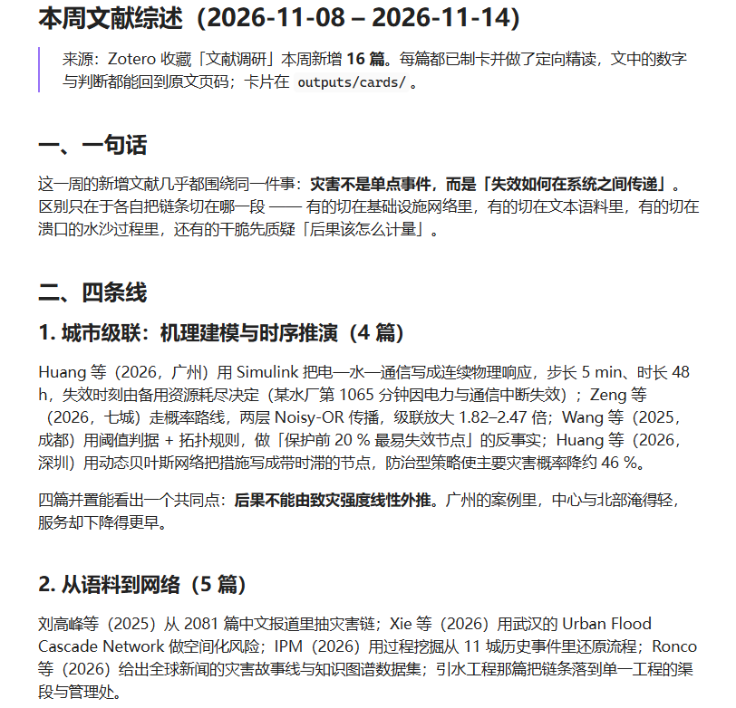

# 文献深度处理（Literature CLI）

从 dailyinfo 迁入的文献处理能力：**精读、主题、公众号、B 站发布**。
它与「文献卡与主题卡」是两条不同的路子 —— 这边产出**当期内容**（文章、分析卡），
那边把文献沉淀成**长期可追溯**的资产。

每周综述的产物长这样（`$OUT/weekly-review/<date>/`）—— 一批新增文献按几条主线归组，每条判断都能回到卡片与原文页码：

{width=720}

## CLI 用法（统一用 `uv run python -m`）

```bash
# 论文 PDF 下载（独立 CLI，无需 MCP 插件）
uv run python scripts/download_paper.py --doi <doi> [--sync]

# PDF 辅助命令(detect/verify，无需浏览器)
uv run python -m hydrolitagent.literature.download_pdf verify <pdf>
uv run python -m hydrolitagent.literature.download_pdf detect <url>

# Zotero 入库(linked_file)
uv run python -m hydrolitagent.literature.zotero_sync <pdf> <doi> --json

# B 站上传(封面自动生成)
uv run python -m hydrolitagent.literature.bilibili_upload <audio.mp3> \
  --title "标题" --tags "AI,水文,科研" [--dry-run]

# 公众号发布
uv run python -m hydrolitagent.literature.wechat.push <polished.md> [--thumb <media_id>]

# 公众号润色
uv run python -m hydrolitagent.literature.wechat.polish <draft.md>

# 配图/封面(需 ZHIPUAI_API_KEY)
uv run python -m hydrolitagent.literature.wechat.figure <article.md>
```

## 依赖的环境变量

| 变量 | 用途 | 归属模块 |
|------|------|---------|
| `ZOTERO_API_KEY` | Zotero Web API 密钥 | zotero_sync.py |
| `ZOTERO_LIBRARY_ID` | Zotero 数字型用户 ID | zotero_sync.py |
| `GDRIVE_PAPERS_PATH` | GDrive 论文文件夹(Linked Attachment Base Directory) | zotero_sync.py |
| `ZHIPUAI_API_KEY` | 智谱 AI(CogView)配图/封面 | wechat/figure.py |
| `WECHAT_APPID` / `WECHAT_APPSECRET` / `WECHAT_THUMB_MEDIA_ID` | 公众号发布 | wechat/push.py |

> ⚠️ 凭据一律从环境变量读取,**不要把 API 密钥硬编码进源码**。`push.py` 曾硬编码微信凭据,迁移时已修复为 env 读取。

## 相关文档

- [论文 PDF 下载（机构访问）](download-pdf.md) — Playwright 浏览器下载
- [Zotero 入库（linked_file）](zotero-sync.md) — PDF → Zotero 条目
- [论文动画课](paper-video.md) — 新机器配置与完整工作流

## 精读产物(知识库)

每周文献综述的产出(分析卡、文章)统一放在 `outputs/weekly-review/{YYYY-MM-DD}/`。

> `outputs/` 只是**默认落点**。产物根可配置——要同步到 OneDrive / Google Drive / 坚果云,
> 设 `HYDROLITAGENT_ROOT`（graph 与文献产物共用）或 `HYDROLITAGENT_LITERATURE_ROOT`
> （只改文献产物）,或改 `configs/paths.toml`。见
> [配置参考](config.md#reading-output-root)。用 `uv run hydrolitagent paths` 查看实际落点。

```
outputs/weekly-review/2026-08-04/
├── cards/         # 8 段分析卡(每篇一篇)
├── article/       # 公众号文章
└── 文献总览.md     # 本期论文分类总览
```

精读流程由 `skills/weekly-review/` 驱动:每篇论文一个子代理精读全文 → 写 8 段分析卡 → 主题聚类 → 文章。

## 相关 Skill

| Skill | 功能 |
|-------|------|
| `weekly-review` | 每周文献综述:精读→卡片→主题→文章 |
| `paper-video` | 单篇论文动画课 |
| `weekly-report-skill` | 周报初稿 → 公众号周报 |
| `figure-skill-v2` | 配图/封面 |
| `bilibili-upload` | B 站发布 |
| `download-pdf` | 论文 PDF 下载(机构访问)+ Zotero 同步 |
