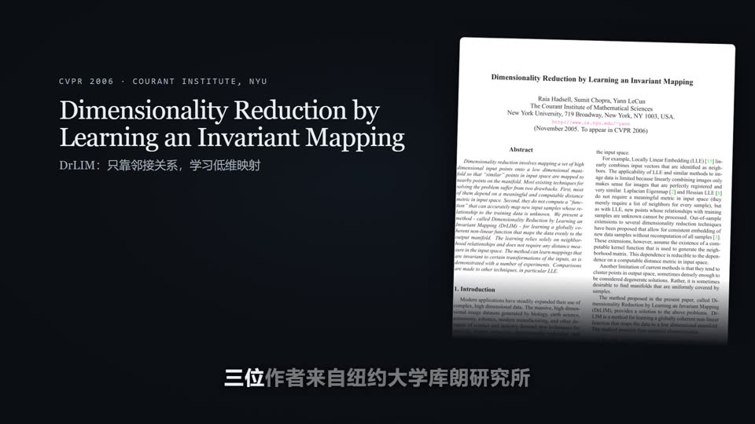
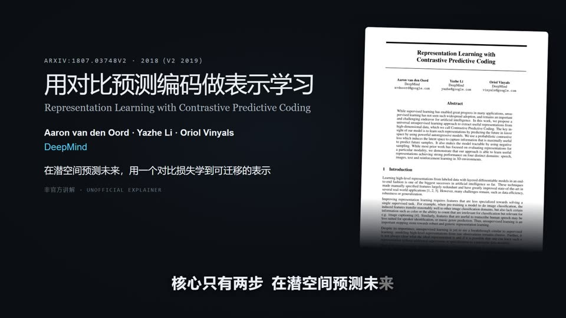

# 论文动画课

在 mylibrary 的项目对话里说「把 Zotero 里的《论文题名》做成中文动画课」，也可以提供条目键、DOI 或本地 PDF。默认制作横屏 1080p 视频，围绕一个核心机制组织动画，再回到论文原图或实验结果。

## 效果示例

下面两期动画课由本工作流生成，均使用免费 Edge 中文旁白、自动字幕和可编辑的 Remotion 工程：

| [](https://www.bilibili.com/video/BV1xGWu68E3x) | [](https://www.bilibili.com/video/BV1NGWu68E8L) |
|---|---|
| **DrLIM**（CVPR 2006）—— 用对比损失学习不变量映射 · [在 B 站观看](https://www.bilibili.com/video/BV1xGWu68E3x) | **CPC**（DeepMind 2018）—— 在潜空间预测未来 · [在 B 站观看](https://www.bilibili.com/video/BV1NGWu68E8L) |

## 首次配置与更新

先安装 Git、Python 3.12–3.14、uv、Node.js 20+（含 npm）和 FFmpeg（含 FFprobe），并确保它们能在终端调用。使用 Zotero 输入时，还需打开 Zotero Desktop 并开启本地 API。然后在仓库根目录运行：

```powershell
uv sync --locked --extra paper-video
uv run --locked --extra paper-video python scripts/paper_video.py setup
```

同一命令也用于更新。它获取上游默认分支、安装本地渲染依赖，并用一句测试文本验证 Edge 中文语音和 Remotion。新版本通过检查才启用，失败时可继续使用上次成功安装的版本。日常运行沿用本机已验证的版本。上游工作流和工具缓存位于 `.tmp/paper2video/`。

| 依赖 | 安装方式 |
|---|---|
| mylibrary 的 Python 依赖 | `uv sync --locked` 根据仓库的 `uv.lock` 安装到项目 `.venv` |
| 视频 Python 依赖 `edge-tts`、`jieba` 和 `numpy` | `pyproject.toml` 的 `paper-video` 可选依赖组，由 `uv sync --locked --extra paper-video` 按锁文件安装到同一项目环境 |
| Remotion、React 等视频依赖 | 配置流程调用 npm 安装，渲染时使用运行工程的 npm 锁文件；渲染浏览器由 Remotion 按需下载 |
| Git、Node.js、FFmpeg 和 FFprobe | 由使用者在系统中安装 |

首次配置需要联网下载依赖和渲染浏览器。使用默认的 Edge 中文旁白时，每次生成配音也需要联网。

## 耗时参考

一次约 3 分钟、10 个镜头的实测，从 PDF 就绪到成片验收约 **37 分钟****。其中约 32 分钟用于理解论文、编写讲稿和制作镜头，期间也安装了运行依赖。中文配音约 7 秒，1080p 渲染和成片检查约 4 分钟。论文复杂度、定制动画数量、依赖下载和电脑性能都会影响耗时。

## 交付与继续

每次生成写到 `outputs/paper2video/<PDF 指纹前缀>/<运行编号>/`。其中 `out/` 保存 MP4 和 SRT，`notes/claims.md` 记录主要说法的出处，`src/`、`public/` 和 `scenes.json` 构成可编辑工程。旁白使用免费 Edge 中文语音，服务接收生成的旁白文本。

渲染或配音中断后，在项目对话中指定原运行目录并要求继续。修改已完成的视频时，另开运行以保留原版。云盘 PDF 不可读时，先在 Zotero 中打开附件，或提供本地 PDF。

每周综述仍单独生成分析卡和公众号文章。已有音视频无需迁移。
